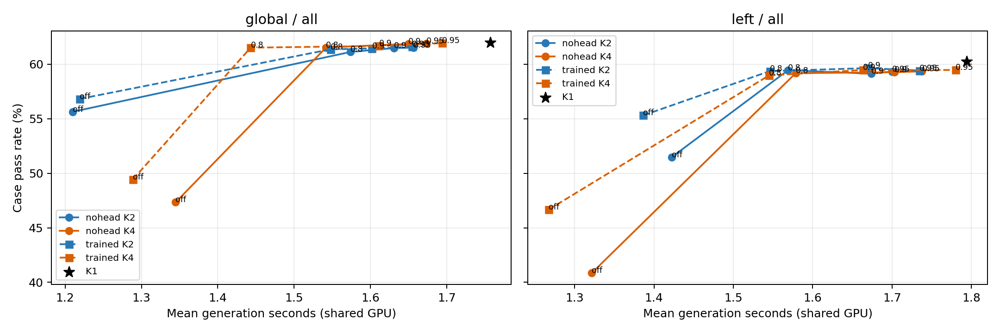
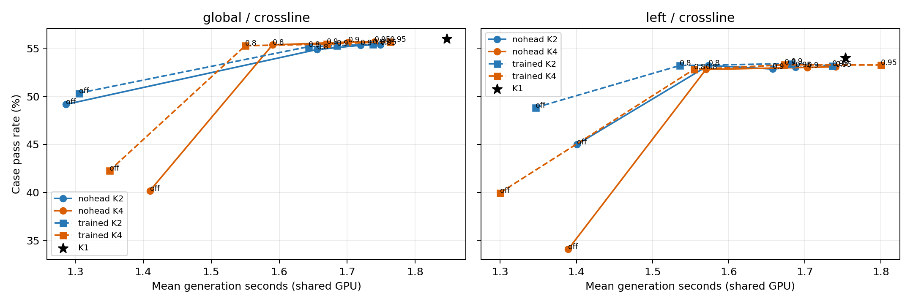
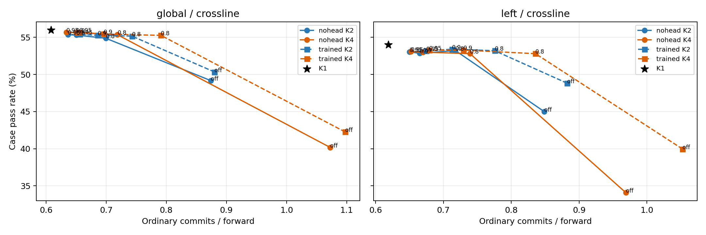

# dreamon_multiline_threshold_128_20261112_v1 官方阈值评测

状态：完整完成。质量生成 197710/197710，评分 197710/197710；计时 16728/16728。

实际生成版本 `ad0f9013a0be84aa109abdf83e06f8ff9fc8a4ab`。34配置，DreamOn revision8ccc747，bf16；旧rank256 v2 KL/full/best头float32、λ=1。seed42、T=.2、top-p=.9、batch1、entropy/alg_temp0、初始mask64、最大长度128、扩展次数预算128、steps256、原扩删/EOS规则；各预算独立生成与评分。

阈值使用实际抽到的普通词在合法完整词表T=1 FP32概率；全轮首个空间候选唯一豁免，拒绝不重抽、不写前驱并停止当前连续链。共同随机键沿用原contract/seed/真实case/round/original_position/purpose。
角色nohead：generation_complete，104670/104670，PID 1957797，UTC 2026-11-21T02:24:23Z。
角色trained：generation_complete，93040/93040，PID 1957802，UTC 2026-11-20T23:48:41Z。
角色timing：timing_complete，16728/16728，PID 3470427，UTC 2026-11-21T16:05:18Z。

## 完整官方人口：5815例 / 164基础题

|配置|成功数/分母|逐例通过率%|相对K1 pp|计时均值秒|中位秒|p90秒|时间比|普通词/NFE|额外接受率|
|---|---:|---:|---:|---:|---:|---:|---:|---:|---:|
|global_k1_nohead_off|3604/5815（已评分5815）|61.98|0.00|1.76|0.70|3.47|1.00|0.60|N/A|
|global_k2_nohead_off|3235/5815（已评分5815）|55.63|-6.35|1.21|0.37|2.72|0.69|0.86|1.00|
|global_k2_nohead_080|3554/5815（已评分5815）|61.12|-0.86|1.57|0.57|3.36|0.90|0.69|0.28|
|global_k2_nohead_090|3575/5815（已评分5815）|61.48|-0.50|1.63|0.63|3.23|0.93|0.64|0.11|
|global_k2_nohead_095|3577/5815（已评分5815）|61.51|-0.46|1.66|0.65|3.33|0.94|0.63|0.07|
|global_k2_trained_off|3304/5815（已评分5815）|56.82|-5.16|1.22|0.37|2.71|0.69|0.87|1.00|
|global_k2_trained_080|3568/5815（已评分5815）|61.36|-0.62|1.55|0.54|3.27|0.88|0.73|0.46|
|global_k2_trained_090|3573/5815（已评分5815）|61.44|-0.53|1.60|0.56|3.34|0.91|0.68|0.24|
|global_k2_trained_095|3581/5815（已评分5815）|61.58|-0.40|1.65|0.63|3.36|0.94|0.65|0.14|
|global_k4_nohead_off|2753/5815（已评分5815）|47.34|-14.63|1.34|0.23|2.82|0.77|1.05|1.00|
|global_k4_nohead_080|3578/5815（已评分5815）|61.53|-0.45|1.54|0.52|3.10|0.88|0.71|0.23|
|global_k4_nohead_090|3597/5815（已评分5815）|61.86|-0.12|1.65|0.60|3.13|0.94|0.64|0.09|
|global_k4_nohead_095|3600/5815（已评分5815）|61.91|-0.07|1.67|0.61|3.12|0.95|0.63|0.06|
|global_k4_trained_off|2875/5815（已评分5815）|49.44|-12.54|1.29|0.23|2.69|0.73|1.07|1.00|
|global_k4_trained_080|3577/5815（已评分5815）|61.51|-0.46|1.44|0.45|3.00|0.82|0.78|0.37|
|global_k4_trained_090|3586/5815（已评分5815）|61.67|-0.31|1.61|0.54|3.07|0.92|0.69|0.19|
|global_k4_trained_095|3601/5815（已评分5815）|61.93|-0.05|1.69|0.60|3.13|0.96|0.65|0.11|
|left_k1_nohead_off|3504/5815（已评分5815）|60.26|0.00|1.79|0.86|2.97|1.00|0.61|N/A|
|left_k2_nohead_off|2993/5815（已评分5815）|51.47|-8.79|1.42|0.56|2.33|0.79|0.83|1.00|
|left_k2_nohead_080|3457/5815（已评分5815）|59.45|-0.81|1.57|0.76|2.50|0.87|0.70|0.26|
|left_k2_nohead_090|3438/5815（已评分5815）|59.12|-1.13|1.67|0.81|2.73|0.93|0.65|0.09|
|left_k2_nohead_095|3450/5815（已评分5815）|59.33|-0.93|1.70|0.81|2.76|0.95|0.64|0.05|
|left_k2_trained_off|3216/5815（已评分5815）|55.31|-4.95|1.39|0.53|2.41|0.77|0.86|1.00|
|left_k2_trained_080|3452/5815（已评分5815）|59.36|-0.89|1.55|0.71|2.44|0.86|0.76|0.48|
|left_k2_trained_090|3468/5815（已评分5815）|59.64|-0.62|1.67|0.74|2.65|0.93|0.70|0.24|
|left_k2_trained_095|3455/5815（已评分5815）|59.42|-0.84|1.73|0.82|2.79|0.97|0.66|0.12|
|left_k4_nohead_off|2376/5815（已评分5815）|40.86|-19.40|1.32|0.58|1.92|0.74|0.95|1.00|
|left_k4_nohead_080|3441/5815（已评分5815）|59.17|-1.08|1.58|0.72|2.49|0.88|0.72|0.25|
|left_k4_nohead_090|3446/5815（已评分5815）|59.26|-1.00|1.70|0.82|2.69|0.95|0.66|0.09|
|left_k4_nohead_095|3451/5815（已评分5815）|59.35|-0.91|1.74|0.81|2.85|0.97|0.64|0.05|
|left_k4_trained_off|2714/5815（已评分5815）|46.67|-13.59|1.27|0.39|1.98|0.71|1.02|1.00|
|left_k4_trained_080|3429/5815（已评分5815）|58.97|-1.29|1.54|0.63|2.61|0.86|0.82|0.44|
|left_k4_trained_090|3458/5815（已评分5815）|59.47|-0.79|1.66|0.74|2.62|0.93|0.71|0.23|
|left_k4_trained_095|3458/5815（已评分5815）|59.47|-0.79|1.78|0.83|3.04|0.99|0.67|0.12|

时间来自该人口固定子集，每配置预期492次，不能称为全5815例时延。跨行使用相同127题/相同案例K1配对；全计时包含37题单行回退。质量不完整时逐例率留空，成功数不得解释为全量结果。
- global K2无头已测阈值最高点0.95：3577/5815；较off +5.88pp，普通词/NFE 0.63。仅本人口内事后描述，所有负结果保留。
- global K4无头已测阈值最高点0.95：3600/5815；较off +14.57pp，普通词/NFE 0.63。仅本人口内事后描述，所有负结果保留。
- left K2无头已测阈值最高点0.8：3457/5815；较off +7.98pp，普通词/NFE 0.70。仅本人口内事后描述，所有负结果保留。
- left K4无头已测阈值最高点0.95：3451/5815；较off +18.49pp，普通词/NFE 0.64。仅本人口内事后描述，所有负结果保留。
- global_k2_trained_off相对无头同阈值：救回95、改错26、净+69；逐例差1.19pp，整题bootstrap95%区间[0.7185609186590894, 1.7630149287714558]。
- global_k2_trained_080相对无头同阈值：救回23、改错9、净+14；逐例差0.24pp，整题bootstrap95%区间[0.03190721479112268, 0.4660967934154787]。
- global_k2_trained_090相对无头同阈值：救回5、改错7、净-2；逐例差-0.03pp，整题bootstrap95%区间[-0.1598724573370261, 0.09072147235890803]。
- global_k2_trained_095相对无头同阈值：救回6、改错2、净+4；逐例差0.07pp，整题bootstrap95%区间[-0.032672007969108983, 0.17670785262022165]。
- global_k4_trained_off相对无头同阈值：救回209、改错87、净+122；逐例差2.10pp，整题bootstrap95%区间[1.222947742033546, 2.9896160629239468]。
- global_k4_trained_080相对无头同阈值：救回43、改错44、净-1；逐例差-0.02pp，整题bootstrap95%区间[-0.3850846576498203, 0.329441899862845]。
- global_k4_trained_090相对无头同阈值：救回14、改错25、净-11；逐例差-0.19pp，整题bootstrap95%区间[-0.4047822130797012, 0.035247130007461755]。
- global_k4_trained_095相对无头同阈值：救回8、改错7、净+1；逐例差0.02pp，整题bootstrap95%区间[-0.12433668837576475, 0.17374822302953719]。
- left_k2_trained_off相对无头同阈值：救回332、改错109、净+223；逐例差3.83pp，整题bootstrap95%区间[2.8561610515169433, 4.973226037600525]。
- left_k2_trained_080相对无头同阈值：救回92、改错97、净-5；逐例差-0.09pp，整题bootstrap95%区间[-0.6333363293956514, 0.4481012176691713]。
- left_k2_trained_090相对无头同阈值：救回106、改错76、净+30；逐例差0.52pp，整题bootstrap95%区间[0.09581346293763024, 0.9078029351900753]。
- left_k2_trained_095相对无头同阈值：救回57、改错52、净+5；逐例差0.09pp，整题bootstrap95%区间[-0.2304763276866872, 0.36637420520764913]。
- left_k4_trained_off相对无头同阈值：救回488、改错150、净+338；逐例差5.81pp，整题bootstrap95%区间[4.296551018928335, 7.448676247446588]。
- left_k4_trained_080相对无头同阈值：救回116、改错128、净-12；逐例差-0.21pp，整题bootstrap95%区间[-0.7981790589353144, 0.37058902610015476]。
- left_k4_trained_090相对无头同阈值：救回100、改错88、净+12；逐例差0.21pp，整题bootstrap95%区间[-0.2039278662492311, 0.6288181121780637]。
- left_k4_trained_095相对无头同阈值：救回60、改错53、净+7；逐例差0.12pp，整题bootstrap95%区间[-0.2099770067599305, 0.4189779775966743]。
头的额外价值：同阈值配对共16点，净正向11点、净负向5点、持平0点；逐点区间与时间开销见表和CSV，不把任一最好点外推到全部跨度。
历史题等权预设标记（下降≤1pp且减时≥20%）：暂无完整实测点满足。共享争用下不作确定达标判断。
逐例预设标记（下降≤1pp且减时≥20%）：暂无完整实测点满足。共享争用下不作确定达标判断。

## 真正跨行人口（至少2行）：4782例 / 127基础题

|配置|成功数/分母|逐例通过率%|相对K1 pp|计时均值秒|中位秒|p90秒|时间比|普通词/NFE|额外接受率|
|---|---:|---:|---:|---:|---:|---:|---:|---:|---:|
|global_k1_nohead_off|2677/4782（已评分4782）|55.98|0.00|1.85|0.73|3.75|1.00|0.61|N/A|
|global_k2_nohead_off|2351/4782（已评分4782）|49.16|-6.82|1.29|0.39|3.07|0.70|0.87|1.00|
|global_k2_nohead_080|2624/4782（已评分4782）|54.87|-1.11|1.66|0.59|3.58|0.90|0.70|0.29|
|global_k2_nohead_090|2645/4782（已评分4782）|55.31|-0.67|1.72|0.66|3.47|0.93|0.65|0.12|
|global_k2_nohead_095|2647/4782（已评分4782）|55.35|-0.63|1.75|0.66|3.49|0.95|0.64|0.07|
|global_k2_trained_off|2407/4782（已评分4782）|50.33|-5.65|1.31|0.39|2.87|0.71|0.88|1.00|
|global_k2_trained_080|2638/4782（已评分4782）|55.17|-0.82|1.64|0.57|3.39|0.89|0.74|0.46|
|global_k2_trained_090|2643/4782（已评分4782）|55.27|-0.71|1.68|0.60|3.48|0.91|0.69|0.24|
|global_k2_trained_095|2650/4782（已评分4782）|55.42|-0.56|1.74|0.64|3.50|0.94|0.66|0.14|
|global_k4_nohead_off|1921/4782（已评分4782）|40.17|-15.81|1.41|0.24|2.85|0.76|1.07|1.00|
|global_k4_nohead_080|2647/4782（已评分4782）|55.35|-0.63|1.59|0.57|3.15|0.86|0.72|0.23|
|global_k4_nohead_090|2661/4782（已评分4782）|55.65|-0.33|1.70|0.63|3.14|0.92|0.65|0.09|
|global_k4_nohead_095|2663/4782（已评分4782）|55.69|-0.29|1.74|0.66|3.18|0.94|0.63|0.06|
|global_k4_trained_off|2021/4782（已评分4782）|42.26|-13.72|1.35|0.24|2.70|0.73|1.10|1.00|
|global_k4_trained_080|2643/4782（已评分4782）|55.27|-0.71|1.55|0.48|3.17|0.84|0.79|0.38|
|global_k4_trained_090|2651/4782（已评分4782）|55.44|-0.54|1.67|0.59|3.10|0.90|0.70|0.19|
|global_k4_trained_095|2663/4782（已评分4782）|55.69|-0.29|1.76|0.63|3.17|0.95|0.66|0.11|
|left_k1_nohead_off|2582/4782（已评分4782）|53.99|0.00|1.75|0.77|2.97|1.00|0.62|N/A|
|left_k2_nohead_off|2152/4782（已评分4782）|45.00|-8.99|1.40|0.49|2.33|0.80|0.85|1.00|
|left_k2_nohead_080|2545/4782（已评分4782）|53.22|-0.77|1.57|0.71|2.59|0.90|0.72|0.26|
|left_k2_nohead_090|2527/4782（已评分4782）|52.84|-1.15|1.66|0.75|2.99|0.95|0.66|0.09|
|left_k2_nohead_095|2537/4782（已评分4782）|53.05|-0.94|1.69|0.76|2.88|0.96|0.65|0.05|
|left_k2_trained_off|2335/4782（已评分4782）|48.83|-5.17|1.35|0.49|2.43|0.77|0.88|1.00|
|left_k2_trained_080|2544/4782（已评分4782）|53.20|-0.79|1.54|0.63|2.54|0.88|0.78|0.48|
|left_k2_trained_090|2554/4782（已评分4782）|53.41|-0.59|1.68|0.70|2.98|0.96|0.71|0.24|
|left_k2_trained_095|2543/4782（已评分4782）|53.18|-0.82|1.74|0.78|3.00|0.99|0.67|0.12|
|left_k4_nohead_off|1630/4782（已评分4782）|34.09|-19.91|1.39|0.74|1.97|0.79|0.97|1.00|
|left_k4_nohead_080|2525/4782（已评分4782）|52.80|-1.19|1.57|0.68|2.52|0.90|0.74|0.25|
|left_k4_nohead_090|2535/4782（已评分4782）|53.01|-0.98|1.70|0.76|2.72|0.97|0.67|0.09|
|left_k4_nohead_095|2538/4782（已评分4782）|53.07|-0.92|1.74|0.76|2.87|0.99|0.65|0.05|
|left_k4_trained_off|1911/4782（已评分4782）|39.96|-14.03|1.30|0.36|2.05|0.74|1.05|1.00|
|left_k4_trained_080|2525/4782（已评分4782）|52.80|-1.19|1.55|0.58|3.02|0.89|0.84|0.44|
|left_k4_trained_090|2548/4782（已评分4782）|53.28|-0.71|1.67|0.72|2.84|0.95|0.73|0.23|
|left_k4_trained_095|2547/4782（已评分4782）|53.26|-0.73|1.80|0.80|3.21|1.03|0.68|0.12|

时间来自该人口固定子集，每配置预期381次，不能称为全4782例时延。跨行使用相同127题/相同案例K1配对；全计时包含37题单行回退。质量不完整时逐例率留空，成功数不得解释为全量结果。
- global K2无头已测阈值最高点0.95：2647/4782；较off +6.19pp，普通词/NFE 0.64。仅本人口内事后描述，所有负结果保留。
- global K4无头已测阈值最高点0.95：2663/4782；较off +15.52pp，普通词/NFE 0.63。仅本人口内事后描述，所有负结果保留。
- left K2无头已测阈值最高点0.8：2545/4782；较off +8.22pp，普通词/NFE 0.72。仅本人口内事后描述，所有负结果保留。
- left K4无头已测阈值最高点0.95：2538/4782；较off +18.99pp，普通词/NFE 0.65。仅本人口内事后描述，所有负结果保留。
- global_k2_trained_off相对无头同阈值：救回82、改错26、净+56；逐例差1.17pp，整题bootstrap95%区间[0.6008739192889417, 1.870421938543381]。
- global_k2_trained_080相对无头同阈值：救回20、改错6、净+14；逐例差0.29pp，整题bootstrap95%区间[0.06837610285851368, 0.5368178750827403]。
- global_k2_trained_090相对无头同阈值：救回4、改错6、净-2；逐例差-0.04pp，整题bootstrap95%区间[-0.18774054974733453, 0.10358508003877152]。
- global_k2_trained_095相对无头同阈值：救回5、改错2、净+3；逐例差0.06pp，整题bootstrap95%区间[-0.05893683759685213, 0.18669169819853723]。
- global_k4_trained_off相对无头同阈值：救回174、改错74、净+100；逐例差2.09pp，整题bootstrap95%区间[1.0568827561744134, 3.1612229384293773]。
- global_k4_trained_080相对无头同阈值：救回35、改错39、净-4；逐例差-0.08pp，整题bootstrap95%区间[-0.4882345127196733, 0.3105260499427929]。
- global_k4_trained_090相对无头同阈值：救回13、改错23、净-10；逐例差-0.21pp，整题bootstrap95%区间[-0.48505075730592756, 0.0640071688739415]。
- global_k4_trained_095相对无头同阈值：救回7、改错7、净+0；逐例差0.00pp，整题bootstrap95%区间[-0.16553408080751242, 0.19056920745318368]。
- left_k2_trained_off相对无头同阈值：救回280、改错97、净+183；逐例差3.83pp，整题bootstrap95%区间[2.6889269425344637, 5.233847288064156]。
- left_k2_trained_080相对无头同阈值：救回84、改错85、净-1；逐例差-0.02pp，整题bootstrap95%区间[-0.6392080383755588, 0.6205076012976273]。
- left_k2_trained_090相对无头同阈值：救回98、改错71、净+27；逐例差0.56pp，整题bootstrap95%区间[0.06936983635841654, 1.0297495372199503]。
- left_k2_trained_095相对无头同阈值：救回54、改错48、净+6；逐例差0.13pp，整题bootstrap95%区间[-0.2559642687476364, 0.4658675404948426]。
- left_k4_trained_off相对无头同阈值：救回411、改错130、净+281；逐例差5.88pp，整题bootstrap95%区间[4.015507352377429, 7.806832556580095]。
- left_k4_trained_080相对无头同阈值：救回108、改错108、净+0；逐例差0.00pp，整题bootstrap95%区间[-0.6440699756182631, 0.687288914480605]。
- left_k4_trained_090相对无头同阈值：救回92、改错79、净+13；逐例差0.27pp，整题bootstrap95%区间[-0.18477296565765156, 0.7643649758204285]。
- left_k4_trained_095相对无头同阈值：救回56、改错47、净+9；逐例差0.19pp，整题bootstrap95%区间[-0.21281743178642892, 0.5496959615669827]。
头的额外价值：同阈值配对共16点，净正向10点、净负向4点、持平2点；逐点区间与时间开销见表和CSV，不把任一最好点外推到全部跨度。
历史题等权预设标记（下降≤1pp且减时≥20%）：暂无完整实测点满足。共享争用下不作确定达标判断。
逐例预设标记（下降≤1pp且减时≥20%）：暂无完整实测点满足。共享争用下不作确定达标判断。

## 原始孔洞跨度分层

|配置|跨度|基础题|成功数/分母|已评分|通过率%|
|---|---|---:|---:|---:|---:|
|global_k1_nohead_off|1|164|927/1033|1033|89.74|
|global_k2_nohead_off|1|164|884/1033|1033|85.58|
|global_k2_nohead_080|1|164|930/1033|1033|90.03|
|global_k2_nohead_090|1|164|930/1033|1033|90.03|
|global_k2_nohead_095|1|164|930/1033|1033|90.03|
|global_k2_trained_off|1|164|897/1033|1033|86.83|
|global_k2_trained_080|1|164|930/1033|1033|90.03|
|global_k2_trained_090|1|164|930/1033|1033|90.03|
|global_k2_trained_095|1|164|931/1033|1033|90.13|
|global_k4_nohead_off|1|164|832/1033|1033|80.54|
|global_k4_nohead_080|1|164|931/1033|1033|90.13|
|global_k4_nohead_090|1|164|936/1033|1033|90.61|
|global_k4_nohead_095|1|164|937/1033|1033|90.71|
|global_k4_trained_off|1|164|854/1033|1033|82.67|
|global_k4_trained_080|1|164|934/1033|1033|90.42|
|global_k4_trained_090|1|164|935/1033|1033|90.51|
|global_k4_trained_095|1|164|938/1033|1033|90.80|
|left_k1_nohead_off|1|164|922/1033|1033|89.25|
|left_k2_nohead_off|1|164|841/1033|1033|81.41|
|left_k2_nohead_080|1|164|912/1033|1033|88.29|
|left_k2_nohead_090|1|164|911/1033|1033|88.19|
|left_k2_nohead_095|1|164|913/1033|1033|88.38|
|left_k2_trained_off|1|164|881/1033|1033|85.29|
|left_k2_trained_080|1|164|908/1033|1033|87.90|
|left_k2_trained_090|1|164|914/1033|1033|88.48|
|left_k2_trained_095|1|164|912/1033|1033|88.29|
|left_k4_nohead_off|1|164|746/1033|1033|72.22|
|left_k4_nohead_080|1|164|916/1033|1033|88.67|
|left_k4_nohead_090|1|164|911/1033|1033|88.19|
|left_k4_nohead_095|1|164|913/1033|1033|88.38|
|left_k4_trained_off|1|164|803/1033|1033|77.73|
|left_k4_trained_080|1|164|904/1033|1033|87.51|
|left_k4_trained_090|1|164|910/1033|1033|88.09|
|left_k4_trained_095|1|164|911/1033|1033|88.19|
|global_k1_nohead_off|2-3|127|1198/1511|1511|79.29|
|global_k2_nohead_off|2-3|127|1091/1511|1511|72.20|
|global_k2_nohead_080|2-3|127|1184/1511|1511|78.36|
|global_k2_nohead_090|2-3|127|1191/1511|1511|78.82|
|global_k2_nohead_095|2-3|127|1192/1511|1511|78.89|
|global_k2_trained_off|2-3|127|1115/1511|1511|73.79|
|global_k2_trained_080|2-3|127|1193/1511|1511|78.95|
|global_k2_trained_090|2-3|127|1191/1511|1511|78.82|
|global_k2_trained_095|2-3|127|1193/1511|1511|78.95|
|global_k4_nohead_off|2-3|127|968/1511|1511|64.06|
|global_k4_nohead_080|2-3|127|1204/1511|1511|79.68|
|global_k4_nohead_090|2-3|127|1209/1511|1511|80.01|
|global_k4_nohead_095|2-3|127|1207/1511|1511|79.88|
|global_k4_trained_off|2-3|127|1015/1511|1511|67.17|
|global_k4_trained_080|2-3|127|1201/1511|1511|79.48|
|global_k4_trained_090|2-3|127|1206/1511|1511|79.81|
|global_k4_trained_095|2-3|127|1209/1511|1511|80.01|
|left_k1_nohead_off|2-3|127|1168/1511|1511|77.30|
|left_k2_nohead_off|2-3|127|1022/1511|1511|67.64|
|left_k2_nohead_080|2-3|127|1158/1511|1511|76.64|
|left_k2_nohead_090|2-3|127|1156/1511|1511|76.51|
|left_k2_nohead_095|2-3|127|1159/1511|1511|76.70|
|left_k2_trained_off|2-3|127|1072/1511|1511|70.95|
|left_k2_trained_080|2-3|127|1151/1511|1511|76.17|
|left_k2_trained_090|2-3|127|1164/1511|1511|77.04|
|left_k2_trained_095|2-3|127|1156/1511|1511|76.51|
|left_k4_nohead_off|2-3|127|831/1511|1511|55.00|
|left_k4_nohead_080|2-3|127|1152/1511|1511|76.24|
|left_k4_nohead_090|2-3|127|1156/1511|1511|76.51|
|left_k4_nohead_095|2-3|127|1159/1511|1511|76.70|
|left_k4_trained_off|2-3|127|935/1511|1511|61.88|
|left_k4_trained_080|2-3|127|1148/1511|1511|75.98|
|left_k4_trained_090|2-3|127|1162/1511|1511|76.90|
|left_k4_trained_095|2-3|127|1158/1511|1511|76.64|
|global_k1_nohead_off|4-7|108|1136/1870|1870|60.75|
|global_k2_nohead_off|4-7|108|976/1870|1870|52.19|
|global_k2_nohead_080|4-7|108|1110/1870|1870|59.36|
|global_k2_nohead_090|4-7|108|1122/1870|1870|60.00|
|global_k2_nohead_095|4-7|108|1123/1870|1870|60.05|
|global_k2_trained_off|4-7|108|999/1870|1870|53.42|
|global_k2_trained_080|4-7|108|1115/1870|1870|59.63|
|global_k2_trained_090|4-7|108|1123/1870|1870|60.05|
|global_k2_trained_095|4-7|108|1124/1870|1870|60.11|
|global_k4_nohead_off|4-7|108|767/1870|1870|41.02|
|global_k4_nohead_080|4-7|108|1116/1870|1870|59.68|
|global_k4_nohead_090|4-7|108|1129/1870|1870|60.37|
|global_k4_nohead_095|4-7|108|1130/1870|1870|60.43|
|global_k4_trained_off|4-7|108|801/1870|1870|42.83|
|global_k4_trained_080|4-7|108|1115/1870|1870|59.63|
|global_k4_trained_090|4-7|108|1120/1870|1870|59.89|
|global_k4_trained_095|4-7|108|1131/1870|1870|60.48|
|left_k1_nohead_off|4-7|108|1076/1870|1870|57.54|
|left_k2_nohead_off|4-7|108|892/1870|1870|47.70|
|left_k2_nohead_080|4-7|108|1066/1870|1870|57.01|
|left_k2_nohead_090|4-7|108|1063/1870|1870|56.84|
|left_k2_nohead_095|4-7|108|1060/1870|1870|56.68|
|left_k2_trained_off|4-7|108|980/1870|1870|52.41|
|left_k2_trained_080|4-7|108|1072/1870|1870|57.33|
|left_k2_trained_090|4-7|108|1070/1870|1870|57.22|
|left_k2_trained_095|4-7|108|1074/1870|1870|57.43|
|left_k4_nohead_off|4-7|108|644/1870|1870|34.44|
|left_k4_nohead_080|4-7|108|1056/1870|1870|56.47|
|left_k4_nohead_090|4-7|108|1064/1870|1870|56.90|
|left_k4_nohead_095|4-7|108|1062/1870|1870|56.79|
|left_k4_trained_off|4-7|108|779/1870|1870|41.66|
|left_k4_trained_080|4-7|108|1060/1870|1870|56.68|
|left_k4_trained_090|4-7|108|1068/1870|1870|57.11|
|left_k4_trained_095|4-7|108|1074/1870|1870|57.43|
|global_k1_nohead_off|8+|60|343/1401|1401|24.48|
|global_k2_nohead_off|8+|60|284/1401|1401|20.27|
|global_k2_nohead_080|8+|60|330/1401|1401|23.55|
|global_k2_nohead_090|8+|60|332/1401|1401|23.70|
|global_k2_nohead_095|8+|60|332/1401|1401|23.70|
|global_k2_trained_off|8+|60|293/1401|1401|20.91|
|global_k2_trained_080|8+|60|330/1401|1401|23.55|
|global_k2_trained_090|8+|60|329/1401|1401|23.48|
|global_k2_trained_095|8+|60|333/1401|1401|23.77|
|global_k4_nohead_off|8+|60|186/1401|1401|13.28|
|global_k4_nohead_080|8+|60|327/1401|1401|23.34|
|global_k4_nohead_090|8+|60|323/1401|1401|23.05|
|global_k4_nohead_095|8+|60|326/1401|1401|23.27|
|global_k4_trained_off|8+|60|205/1401|1401|14.63|
|global_k4_trained_080|8+|60|327/1401|1401|23.34|
|global_k4_trained_090|8+|60|325/1401|1401|23.20|
|global_k4_trained_095|8+|60|323/1401|1401|23.05|
|left_k1_nohead_off|8+|60|338/1401|1401|24.13|
|left_k2_nohead_off|8+|60|238/1401|1401|16.99|
|left_k2_nohead_080|8+|60|321/1401|1401|22.91|
|left_k2_nohead_090|8+|60|308/1401|1401|21.98|
|left_k2_nohead_095|8+|60|318/1401|1401|22.70|
|left_k2_trained_off|8+|60|283/1401|1401|20.20|
|left_k2_trained_080|8+|60|321/1401|1401|22.91|
|left_k2_trained_090|8+|60|320/1401|1401|22.84|
|left_k2_trained_095|8+|60|313/1401|1401|22.34|
|left_k4_nohead_off|8+|60|155/1401|1401|11.06|
|left_k4_nohead_080|8+|60|317/1401|1401|22.63|
|left_k4_nohead_090|8+|60|315/1401|1401|22.48|
|left_k4_nohead_095|8+|60|317/1401|1401|22.63|
|left_k4_trained_off|8+|60|197/1401|1401|14.06|
|left_k4_trained_080|8+|60|317/1401|1401|22.63|
|left_k4_trained_090|8+|60|318/1401|1401|22.70|
|left_k4_trained_095|8+|60|315/1401|1401|22.48|

## 解释边界与证据

MultiLine名称不等于实际跨行；跨度由task_id原始Lstart_Lend端点定义。全5815=1033+4782；跨行分1511/1870/1401。37基础题无跨行。总体最高点不自动是跨行最高点。single-line与multi-line共享164基础题及部分输入，本轮是任务形态迁移，不是独立新题泛化，不能拼接独立样本。未打开封存external test或旧test lock。

最大长度128仍可能限制长孔洞。summary与span_summary保存生成长度、剩余mask、step-budget耗尽、未完成率、NFE、普通提交分布、额外接受/拒绝、链跳过、结构/no-op、头调用和峰值显存；不按答案或早期通过率改预算、阈值或删样本。K1额外接受率N/A。

配对救回/改错/净变化见paired_comparisons.csv，覆盖对应K1、同方法off、同阈值另一方法及全部跨度层。10000次整题bootstrap只重采样当前人口真实存在基础题（164/127/164/127/108/60），缺席题不补0。逐例通过率为主，题等权仅辅助。nearest_quality.csv按已测逐例率寻找另一方法相近点；不假定头与无头置信度校准。

统一计时164固定例×34×3=16728；127跨行题12954次，37单行回退3774次。每次恢复预热、CUDA同步、稳定轮换配置；包括模型/头/阈值/选位/采样/结构，排除加载、测试、写盘和重型轨迹。质量双worker阶段时延仅负载观测。H200非独占，timing_environment与GPU日志记外部争用，不能宣称确定速度达标。

可复算证据per_case.jsonl.gz、timing_per_case.jsonl.gz；attempts.json保存基础设施尝试。普通失败和3秒超时不重抽。完整性、缺失、重复、无效、版本和计时token分歧见integrity_audit.json。reviewer_gate_disabled：本地diff review + fresh tests；原始日志、权重和重型trace不进Git。

恢复入口：resume.md与checkpoint.md。
