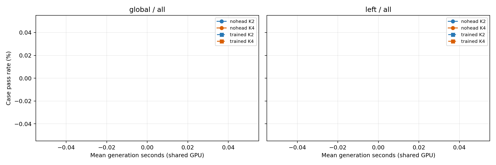
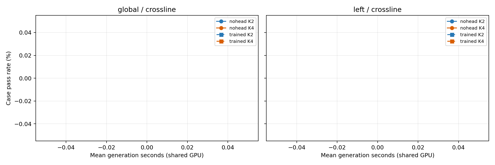
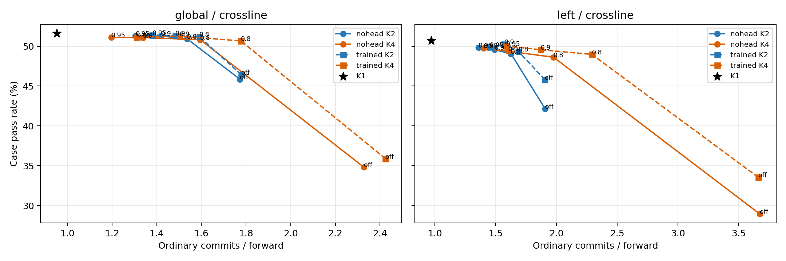

# dreamon_multiline_threshold_20261111_v1 官方阈值评测

状态：未完成，不能作完整实验结论。质量生成 197710/197710，评分 197710/197710；计时 0/16728。

实际生成版本 `ae0283e60fbd60603c3587f2c7394a3b6081a18d`。34配置，DreamOn revision8ccc747，bf16；旧rank256 v2 KL/full/best头float32、λ=1。seed42、T=.2、top-p=.9、batch1、entropy/alg_temp0、初始mask64、steps256、原扩删/EOS规则；不复用旧single-line生成或评分。

阈值使用实际抽到的普通词在合法完整词表T=1 FP32概率；全轮首个空间候选唯一豁免，拒绝不重抽、不写前驱并停止当前连续链。共同随机键沿用原contract/seed/真实case/round/original_position/purpose。
角色nohead：generation_complete，104670/104670，PID 1475777，UTC 2026-11-12T23:43:22Z。
角色trained：generation_complete，93040/93040，PID 1475780，UTC 2026-11-12T23:20:20Z。
角色timing：oom_process_exit，0/16728，PID 1970826，UTC 2026-11-13T06:05:56Z。

## 完整官方人口：5815例 / 164基础题

|配置|成功数/分母|逐例通过率%|相对K1 pp|计时均值秒|中位秒|p90秒|时间比|普通词/NFE|额外接受率|
|---|---:|---:|---:|---:|---:|---:|---:|---:|---:|
|global_k1_nohead_off|3418/5815（已评分5815）|58.78|0.00|未完成|未完成|未完成|未完成|0.95|N/A|
|global_k2_nohead_off|3095/5815（已评分5815）|53.22|-5.55|未完成|未完成|未完成|未完成|1.76|1.00|
|global_k2_nohead_080|3376/5815（已评分5815）|58.06|-0.72|未完成|未完成|未完成|未完成|1.53|0.69|
|global_k2_nohead_090|3399/5815（已评分5815）|58.45|-0.33|未完成|未完成|未完成|未完成|1.42|0.55|
|global_k2_nohead_095|3405/5815（已评分5815）|58.56|-0.22|未完成|未完成|未完成|未完成|1.30|0.41|
|global_k2_trained_off|3133/5815（已评分5815）|53.88|-4.90|未完成|未完成|未完成|未完成|1.76|1.00|
|global_k2_trained_080|3395/5815（已评分5815）|58.38|-0.40|未完成|未完成|未完成|未完成|1.58|0.75|
|global_k2_trained_090|3405/5815（已评分5815）|58.56|-0.22|未完成|未完成|未完成|未完成|1.48|0.62|
|global_k2_trained_095|3407/5815（已评分5815）|58.59|-0.19|未完成|未完成|未完成|未完成|1.38|0.50|
|global_k4_nohead_off|2487/5815（已评分5815）|42.77|-16.01|未完成|未完成|未完成|未完成|2.29|1.00|
|global_k4_nohead_080|3373/5815（已评分5815）|58.01|-0.77|未完成|未完成|未完成|未完成|1.59|0.49|
|global_k4_nohead_090|3391/5815（已评分5815）|58.31|-0.46|未完成|未完成|未完成|未完成|1.33|0.35|
|global_k4_nohead_095|3396/5815（已评分5815）|58.40|-0.38|未完成|未完成|未完成|未完成|1.19|0.26|
|global_k4_trained_off|2555/5815（已评分5815）|43.94|-14.84|未完成|未完成|未完成|未完成|2.39|1.00|
|global_k4_trained_080|3371/5815（已评分5815）|57.97|-0.81|未完成|未完成|未完成|未完成|1.77|0.59|
|global_k4_trained_090|3403/5815（已评分5815）|58.52|-0.26|未完成|未完成|未完成|未完成|1.50|0.44|
|global_k4_trained_095|3399/5815（已评分5815）|58.45|-0.33|未完成|未完成|未完成|未完成|1.30|0.34|
|left_k1_nohead_off|3368/5815（已评分5815）|57.92|0.00|未完成|未完成|未完成|未完成|0.96|N/A|
|left_k2_nohead_off|2891/5815（已评分5815）|49.72|-8.20|未完成|未完成|未完成|未完成|1.89|1.00|
|left_k2_nohead_080|3266/5815（已评分5815）|56.17|-1.75|未完成|未完成|未完成|未完成|1.62|0.69|
|left_k2_nohead_090|3301/5815（已评分5815）|56.77|-1.15|未完成|未完成|未完成|未完成|1.48|0.54|
|left_k2_nohead_095|3316/5815（已评分5815）|57.02|-0.89|未完成|未完成|未完成|未完成|1.36|0.40|
|left_k2_trained_off|3092/5815（已评分5815）|53.17|-4.75|未完成|未完成|未完成|未完成|1.89|1.00|
|left_k2_trained_080|3294/5815（已评分5815）|56.65|-1.27|未完成|未完成|未完成|未完成|1.68|0.76|
|left_k2_trained_090|3340/5815（已评分5815）|57.44|-0.48|未完成|未完成|未完成|未完成|1.56|0.63|
|left_k2_trained_095|3318/5815（已评分5815）|57.06|-0.86|未完成|未完成|未完成|未完成|1.45|0.50|
|left_k4_nohead_off|2099/5815（已评分5815）|36.10|-21.82|未完成|未完成|未完成|未完成|3.63|1.00|
|left_k4_nohead_080|3254/5815（已评分5815）|55.96|-1.96|未完成|未完成|未完成|未完成|1.97|0.54|
|left_k4_nohead_090|3296/5815（已评分5815）|56.68|-1.24|未完成|未完成|未完成|未完成|1.60|0.40|
|left_k4_nohead_095|3314/5815（已评分5815）|56.99|-0.93|未完成|未完成|未完成|未完成|1.40|0.30|
|left_k4_trained_off|2382/5815（已评分5815）|40.96|-16.96|未完成|未完成|未完成|未完成|3.62|1.00|
|left_k4_trained_080|3277/5815（已评分5815）|56.35|-1.56|未完成|未完成|未完成|未完成|2.28|0.65|
|left_k4_trained_090|3306/5815（已评分5815）|56.85|-1.07|未完成|未完成|未完成|未完成|1.87|0.51|
|left_k4_trained_095|3326/5815（已评分5815）|57.20|-0.72|未完成|未完成|未完成|未完成|1.58|0.39|

时间来自该人口固定子集，每配置预期492次，不能称为全5815例时延。跨行使用相同127题/相同案例K1配对；全计时包含37题单行回退。质量不完整时逐例率留空，成功数不得解释为全量结果。
- global K2无头已测阈值最高点0.95：3405/5815；较off +5.33pp，普通词/NFE 1.30。仅本人口内事后描述，所有负结果保留。
- global K4无头已测阈值最高点0.95：3396/5815；较off +15.63pp，普通词/NFE 1.19。仅本人口内事后描述，所有负结果保留。
- left K2无头已测阈值最高点0.95：3316/5815；较off +7.31pp，普通词/NFE 1.36。仅本人口内事后描述，所有负结果保留。
- left K4无头已测阈值最高点0.95：3314/5815；较off +20.89pp，普通词/NFE 1.40。仅本人口内事后描述，所有负结果保留。
- global_k2_trained_off相对无头同阈值：救回75、改错37、净+38；逐例差0.65pp，整题bootstrap95%区间[0.15967515712727628, 1.192080131855105]。
- global_k2_trained_080相对无头同阈值：救回32、改错13、净+19；逐例差0.33pp，整题bootstrap95%区间[0.02899031657606628, 0.6804338479462404]。
- global_k2_trained_090相对无头同阈值：救回12、改错6、净+6；逐例差0.10pp，整题bootstrap95%区间[-0.08879792090100251, 0.3371138036354302]。
- global_k2_trained_095相对无头同阈值：救回4、改错2、净+2；逐例差0.03pp，整题bootstrap95%区间[-0.034578146611341634, 0.1037344398340249]。
- global_k4_trained_off相对无头同阈值：救回144、改错76、净+68；逐例差1.17pp，整题bootstrap95%区间[0.4765392659615984, 1.8908648105700763]。
- global_k4_trained_080相对无头同阈值：救回41、改错43、净-2；逐例差-0.03pp，整题bootstrap95%区间[-0.4582165037368473, 0.38440343927741005]。
- global_k4_trained_090相对无头同阈值：救回31、改错19、净+12；逐例差0.21pp，整题bootstrap95%区间[-0.07494201562980674, 0.5210170813863945]。
- global_k4_trained_095相对无头同阈值：救回18、改错15、净+3；逐例差0.05pp，整题bootstrap95%区间[-0.16860539650549144, 0.2650662559735168]。
- left_k2_trained_off相对无头同阈值：救回285、改错84、净+201；逐例差3.46pp，整题bootstrap95%区间[2.4310450966629054, 4.670670841806415]。
- left_k2_trained_080相对无头同阈值：救回87、改错59、净+28；逐例差0.48pp，整题bootstrap95%区间[-0.03317327238352388, 1.0467194544965863]。
- left_k2_trained_090相对无头同阈值：救回80、改错41、净+39；逐例差0.67pp，整题bootstrap95%区间[0.2771067308196573, 1.0815573919291688]。
- left_k2_trained_095相对无头同阈值：救回43、改错41、净+2；逐例差0.03pp，整题bootstrap95%区间[-0.3371853363050116, 0.3749258707110876]。
- left_k4_trained_off相对无头同阈值：救回407、改错124、净+283；逐例差4.87pp，整题bootstrap95%区间[3.662987692461009, 6.1647766750017565]。
- left_k4_trained_080相对无头同阈值：救回118、改错95、净+23；逐例差0.40pp，整题bootstrap95%区间[-0.32864894514613874, 1.108649440019042]。
- left_k4_trained_090相对无头同阈值：救回91、改错81、净+10；逐例差0.17pp，整题bootstrap95%区间[-0.33321821911865346, 0.6635563844997833]。
- left_k4_trained_095相对无头同阈值：救回64、改错52、净+12；逐例差0.21pp，整题bootstrap95%区间[-0.19973852868415842, 0.598150063986891]。
头的额外价值：同阈值配对共16点，净正向15点、净负向1点、持平0点；逐点区间与时间开销见表和CSV，不把任一最好点外推到全部跨度。
历史题等权预设标记（下降≤1pp且减时≥20%）：暂无完整实测点满足。共享争用下不作确定达标判断。
逐例预设标记（下降≤1pp且减时≥20%）：暂无完整实测点满足。共享争用下不作确定达标判断。

## 真正跨行人口（至少2行）：4782例 / 127基础题

|配置|成功数/分母|逐例通过率%|相对K1 pp|计时均值秒|中位秒|p90秒|时间比|普通词/NFE|额外接受率|
|---|---:|---:|---:|---:|---:|---:|---:|---:|---:|
|global_k1_nohead_off|2468/4782（已评分4782）|51.61|0.00|未完成|未完成|未完成|未完成|0.95|N/A|
|global_k2_nohead_off|2193/4782（已评分4782）|45.86|-5.75|未完成|未完成|未完成|未完成|1.77|1.00|
|global_k2_nohead_080|2436/4782（已评分4782）|50.94|-0.67|未完成|未完成|未完成|未完成|1.54|0.69|
|global_k2_nohead_090|2452/4782（已评分4782）|51.28|-0.33|未完成|未完成|未完成|未完成|1.42|0.54|
|global_k2_nohead_095|2453/4782（已评分4782）|51.30|-0.31|未完成|未完成|未完成|未完成|1.31|0.41|
|global_k2_trained_off|2221/4782（已评分4782）|46.45|-5.17|未完成|未完成|未完成|未完成|1.78|1.00|
|global_k2_trained_080|2448/4782（已评分4782）|51.19|-0.42|未完成|未完成|未完成|未完成|1.59|0.75|
|global_k2_trained_090|2455/4782（已评分4782）|51.34|-0.27|未完成|未完成|未完成|未完成|1.48|0.62|
|global_k2_trained_095|2457/4782（已评分4782）|51.38|-0.23|未完成|未完成|未完成|未完成|1.38|0.50|
|global_k4_nohead_off|1666/4782（已评分4782）|34.84|-16.77|未完成|未完成|未完成|未完成|2.33|1.00|
|global_k4_nohead_080|2430/4782（已评分4782）|50.82|-0.79|未完成|未完成|未完成|未完成|1.60|0.48|
|global_k4_nohead_090|2443/4782（已评分4782）|51.09|-0.52|未完成|未完成|未完成|未完成|1.34|0.34|
|global_k4_nohead_095|2444/4782（已评分4782）|51.11|-0.50|未完成|未完成|未完成|未完成|1.20|0.26|
|global_k4_trained_off|1717/4782（已评分4782）|35.91|-15.70|未完成|未完成|未完成|未完成|2.42|1.00|
|global_k4_trained_080|2423/4782（已评分4782）|50.67|-0.94|未完成|未完成|未完成|未完成|1.78|0.59|
|global_k4_trained_090|2451/4782（已评分4782）|51.25|-0.36|未完成|未完成|未完成|未完成|1.50|0.44|
|global_k4_trained_095|2445/4782（已评分4782）|51.13|-0.48|未完成|未完成|未完成|未完成|1.31|0.33|
|left_k1_nohead_off|2424/4782（已评分4782）|50.69|0.00|未完成|未完成|未完成|未完成|0.97|N/A|
|left_k2_nohead_off|2017/4782（已评分4782）|42.18|-8.51|未完成|未完成|未完成|未完成|1.91|1.00|
|left_k2_nohead_080|2345/4782（已评分4782）|49.04|-1.65|未完成|未完成|未完成|未完成|1.63|0.69|
|left_k2_nohead_090|2371/4782（已评分4782）|49.58|-1.11|未完成|未完成|未完成|未完成|1.49|0.54|
|left_k2_nohead_095|2383/4782（已评分4782）|49.83|-0.86|未完成|未完成|未完成|未完成|1.36|0.40|
|left_k2_trained_off|2190/4782（已评分4782）|45.80|-4.89|未完成|未完成|未完成|未完成|1.91|1.00|
|left_k2_trained_080|2360/4782（已评分4782）|49.35|-1.34|未完成|未完成|未完成|未完成|1.69|0.76|
|left_k2_trained_090|2403/4782（已评分4782）|50.25|-0.44|未完成|未完成|未完成|未完成|1.57|0.63|
|left_k2_trained_095|2385/4782（已评分4782）|49.87|-0.82|未完成|未完成|未完成|未完成|1.45|0.50|
|left_k4_nohead_off|1385/4782（已评分4782）|28.96|-21.73|未完成|未完成|未完成|未完成|3.67|1.00|
|left_k4_nohead_080|2325/4782（已评分4782）|48.62|-2.07|未完成|未完成|未完成|未完成|1.98|0.54|
|left_k4_nohead_090|2361/4782（已评分4782）|49.37|-1.32|未完成|未完成|未完成|未完成|1.60|0.40|
|left_k4_nohead_095|2378/4782（已评分4782）|49.73|-0.96|未完成|未完成|未完成|未完成|1.40|0.30|
|left_k4_trained_off|1605/4782（已评分4782）|33.56|-17.13|未完成|未完成|未完成|未完成|3.66|1.00|
|left_k4_trained_080|2342/4782（已评分4782）|48.98|-1.71|未完成|未完成|未完成|未完成|2.29|0.65|
|left_k4_trained_090|2370/4782（已评分4782）|49.56|-1.13|未完成|未完成|未完成|未完成|1.87|0.51|
|left_k4_trained_095|2392/4782（已评分4782）|50.02|-0.67|未完成|未完成|未完成|未完成|1.59|0.39|

时间来自该人口固定子集，每配置预期381次，不能称为全4782例时延。跨行使用相同127题/相同案例K1配对；全计时包含37题单行回退。质量不完整时逐例率留空，成功数不得解释为全量结果。
- global K2无头已测阈值最高点0.95：2453/4782；较off +5.44pp，普通词/NFE 1.31。仅本人口内事后描述，所有负结果保留。
- global K4无头已测阈值最高点0.95：2444/4782；较off +16.27pp，普通词/NFE 1.20。仅本人口内事后描述，所有负结果保留。
- left K2无头已测阈值最高点0.95：2383/4782；较off +7.65pp，普通词/NFE 1.36。仅本人口内事后描述，所有负结果保留。
- left K4无头已测阈值最高点0.95：2378/4782；较off +20.77pp，普通词/NFE 1.40。仅本人口内事后描述，所有负结果保留。
- global_k2_trained_off相对无头同阈值：救回60、改错32、净+28；逐例差0.59pp，整题bootstrap95%区间[0.05547183583870876, 1.2033493838055527]。
- global_k2_trained_080相对无头同阈值：救回23、改错11、净+12；逐例差0.25pp，整题bootstrap95%区间[-0.04394759379039314, 0.5938903622529775]。
- global_k2_trained_090相对无头同阈值：救回7、改错4、净+3；逐例差0.06pp，整题bootstrap95%区间[-0.10811161887152361, 0.2766330078182129]。
- global_k2_trained_095相对无头同阈值：救回4、改错0、净+4；逐例差0.08pp，整题bootstrap95%区间[0.01900409064723481, 0.16939731662570412]。
- global_k4_trained_off相对无头同阈值：救回116、改错65、净+51；逐例差1.07pp，整题bootstrap95%区间[0.2777355972759065, 1.8818832660876081]。
- global_k4_trained_080相对无头同阈值：救回31、改错38、净-7；逐例差-0.15pp，整题bootstrap95%区间[-0.6172903038897275, 0.29234744642809013]。
- global_k4_trained_090相对无头同阈值：救回24、改错16、净+8；逐例差0.17pp，整题bootstrap95%区间[-0.1205111480450536, 0.5249401264666861]。
- global_k4_trained_095相对无头同阈值：救回14、改错13、净+1；逐例差0.02pp，整题bootstrap95%区间[-0.2302423333604479, 0.25034178158146464]。
- left_k2_trained_off相对无头同阈值：救回250、改错77、净+173；逐例差3.62pp，整题bootstrap95%区间[2.4405243019648397, 5.105896366287236]。
- left_k2_trained_080相对无头同阈值：救回70、改错55、净+15；逐例差0.31pp，整题bootstrap95%区间[-0.24987676577525825, 0.9021364268531046]。
- left_k2_trained_090相对无头同阈值：救回71、改错39、净+32；逐例差0.67pp，整题bootstrap95%区间[0.18929887350642252, 1.1645846640006872]。
- left_k2_trained_095相对无头同阈值：救回40、改错38、净+2；逐例差0.04pp，整题bootstrap95%区间[-0.41101898772851436, 0.45290294779794565]。
- left_k4_trained_off相对无头同阈值：救回331、改错111、净+220；逐例差4.60pp，整题bootstrap95%区间[3.2855311472955124, 6.077964292202367]。
- left_k4_trained_080相对无头同阈值：救回99、改错82、净+17；逐例差0.36pp，整题bootstrap95%区间[-0.40170957307322164, 1.0966436174386134]。
- left_k4_trained_090相对无头同阈值：救回82、改错73、净+9；逐例差0.19pp，整题bootstrap95%区间[-0.4013106175912253, 0.7671830297164305]。
- left_k4_trained_095相对无头同阈值：救回61、改错47、净+14；逐例差0.29pp，整题bootstrap95%区间[-0.20867266821152086, 0.7761554541871567]。
头的额外价值：同阈值配对共16点，净正向15点、净负向1点、持平0点；逐点区间与时间开销见表和CSV，不把任一最好点外推到全部跨度。
历史题等权预设标记（下降≤1pp且减时≥20%）：暂无完整实测点满足。共享争用下不作确定达标判断。
逐例预设标记（下降≤1pp且减时≥20%）：暂无完整实测点满足。共享争用下不作确定达标判断。

## 原始孔洞跨度分层

|配置|跨度|基础题|成功数/分母|已评分|通过率%|
|---|---|---:|---:|---:|---:|
|global_k1_nohead_off|1|164|950/1033|1033|91.97|
|global_k2_nohead_off|1|164|902/1033|1033|87.32|
|global_k2_nohead_080|1|164|940/1033|1033|91.00|
|global_k2_nohead_090|1|164|947/1033|1033|91.67|
|global_k2_nohead_095|1|164|952/1033|1033|92.16|
|global_k2_trained_off|1|164|912/1033|1033|88.29|
|global_k2_trained_080|1|164|947/1033|1033|91.67|
|global_k2_trained_090|1|164|950/1033|1033|91.97|
|global_k2_trained_095|1|164|950/1033|1033|91.97|
|global_k4_nohead_off|1|164|821/1033|1033|79.48|
|global_k4_nohead_080|1|164|943/1033|1033|91.29|
|global_k4_nohead_090|1|164|948/1033|1033|91.77|
|global_k4_nohead_095|1|164|952/1033|1033|92.16|
|global_k4_trained_off|1|164|838/1033|1033|81.12|
|global_k4_trained_080|1|164|948/1033|1033|91.77|
|global_k4_trained_090|1|164|952/1033|1033|92.16|
|global_k4_trained_095|1|164|954/1033|1033|92.35|
|left_k1_nohead_off|1|164|944/1033|1033|91.38|
|left_k2_nohead_off|1|164|874/1033|1033|84.61|
|left_k2_nohead_080|1|164|921/1033|1033|89.16|
|left_k2_nohead_090|1|164|930/1033|1033|90.03|
|left_k2_nohead_095|1|164|933/1033|1033|90.32|
|left_k2_trained_off|1|164|902/1033|1033|87.32|
|left_k2_trained_080|1|164|934/1033|1033|90.42|
|left_k2_trained_090|1|164|937/1033|1033|90.71|
|left_k2_trained_095|1|164|933/1033|1033|90.32|
|left_k4_nohead_off|1|164|714/1033|1033|69.12|
|left_k4_nohead_080|1|164|929/1033|1033|89.93|
|left_k4_nohead_090|1|164|935/1033|1033|90.51|
|left_k4_nohead_095|1|164|936/1033|1033|90.61|
|left_k4_trained_off|1|164|777/1033|1033|75.22|
|left_k4_trained_080|1|164|935/1033|1033|90.51|
|left_k4_trained_090|1|164|936/1033|1033|90.61|
|left_k4_trained_095|1|164|934/1033|1033|90.42|
|global_k1_nohead_off|2-3|127|1202/1511|1511|79.55|
|global_k2_nohead_off|2-3|127|1096/1511|1511|72.53|
|global_k2_nohead_080|2-3|127|1191/1511|1511|78.82|
|global_k2_nohead_090|2-3|127|1195/1511|1511|79.09|
|global_k2_nohead_095|2-3|127|1196/1511|1511|79.15|
|global_k2_trained_off|2-3|127|1111/1511|1511|73.53|
|global_k2_trained_080|2-3|127|1198/1511|1511|79.29|
|global_k2_trained_090|2-3|127|1199/1511|1511|79.35|
|global_k2_trained_095|2-3|127|1198/1511|1511|79.29|
|global_k4_nohead_off|2-3|127|893/1511|1511|59.10|
|global_k4_nohead_080|2-3|127|1187/1511|1511|78.56|
|global_k4_nohead_090|2-3|127|1195/1511|1511|79.09|
|global_k4_nohead_095|2-3|127|1195/1511|1511|79.09|
|global_k4_trained_off|2-3|127|917/1511|1511|60.69|
|global_k4_trained_080|2-3|127|1189/1511|1511|78.69|
|global_k4_trained_090|2-3|127|1195/1511|1511|79.09|
|global_k4_trained_095|2-3|127|1194/1511|1511|79.02|
|left_k1_nohead_off|2-3|127|1195/1511|1511|79.09|
|left_k2_nohead_off|2-3|127|1028/1511|1511|68.03|
|left_k2_nohead_080|2-3|127|1160/1511|1511|76.77|
|left_k2_nohead_090|2-3|127|1171/1511|1511|77.50|
|left_k2_nohead_095|2-3|127|1173/1511|1511|77.63|
|left_k2_trained_off|2-3|127|1088/1511|1511|72.01|
|left_k2_trained_080|2-3|127|1176/1511|1511|77.83|
|left_k2_trained_090|2-3|127|1178/1511|1511|77.96|
|left_k2_trained_095|2-3|127|1174/1511|1511|77.70|
|left_k4_nohead_off|2-3|127|761/1511|1511|50.36|
|left_k4_nohead_080|2-3|127|1147/1511|1511|75.91|
|left_k4_nohead_090|2-3|127|1169/1511|1511|77.37|
|left_k4_nohead_095|2-3|127|1171/1511|1511|77.50|
|left_k4_trained_off|2-3|127|852/1511|1511|56.39|
|left_k4_trained_080|2-3|127|1156/1511|1511|76.51|
|left_k4_trained_090|2-3|127|1176/1511|1511|77.83|
|left_k4_trained_095|2-3|127|1176/1511|1511|77.83|
|global_k1_nohead_off|4-7|108|1051/1870|1870|56.20|
|global_k2_nohead_off|4-7|108|901/1870|1870|48.18|
|global_k2_nohead_080|4-7|108|1035/1870|1870|55.35|
|global_k2_nohead_090|4-7|108|1045/1870|1870|55.88|
|global_k2_nohead_095|4-7|108|1044/1870|1870|55.83|
|global_k2_trained_off|4-7|108|907/1870|1870|48.50|
|global_k2_trained_080|4-7|108|1037/1870|1870|55.45|
|global_k2_trained_090|4-7|108|1046/1870|1870|55.94|
|global_k2_trained_095|4-7|108|1046/1870|1870|55.94|
|global_k4_nohead_off|4-7|108|670/1870|1870|35.83|
|global_k4_nohead_080|4-7|108|1036/1870|1870|55.40|
|global_k4_nohead_090|4-7|108|1045/1870|1870|55.88|
|global_k4_nohead_095|4-7|108|1047/1870|1870|55.99|
|global_k4_trained_off|4-7|108|698/1870|1870|37.33|
|global_k4_trained_080|4-7|108|1027/1870|1870|54.92|
|global_k4_trained_090|4-7|108|1046/1870|1870|55.94|
|global_k4_trained_095|4-7|108|1043/1870|1870|55.78|
|left_k1_nohead_off|4-7|108|1023/1870|1870|54.71|
|left_k2_nohead_off|4-7|108|842/1870|1870|45.03|
|left_k2_nohead_080|4-7|108|994/1870|1870|53.16|
|left_k2_nohead_090|4-7|108|1003/1870|1870|53.64|
|left_k2_nohead_095|4-7|108|1007/1870|1870|53.85|
|left_k2_trained_off|4-7|108|917/1870|1870|49.04|
|left_k2_trained_080|4-7|108|998/1870|1870|53.37|
|left_k2_trained_090|4-7|108|1021/1870|1870|54.60|
|left_k2_trained_095|4-7|108|1017/1870|1870|54.39|
|left_k4_nohead_off|4-7|108|539/1870|1870|28.82|
|left_k4_nohead_080|4-7|108|984/1870|1870|52.62|
|left_k4_nohead_090|4-7|108|996/1870|1870|53.26|
|left_k4_nohead_095|4-7|108|1005/1870|1870|53.74|
|left_k4_trained_off|4-7|108|658/1870|1870|35.19|
|left_k4_trained_080|4-7|108|987/1870|1870|52.78|
|left_k4_trained_090|4-7|108|999/1870|1870|53.42|
|left_k4_trained_095|4-7|108|1022/1870|1870|54.65|
|global_k1_nohead_off|8+|60|215/1401|1401|15.35|
|global_k2_nohead_off|8+|60|196/1401|1401|13.99|
|global_k2_nohead_080|8+|60|210/1401|1401|14.99|
|global_k2_nohead_090|8+|60|212/1401|1401|15.13|
|global_k2_nohead_095|8+|60|213/1401|1401|15.20|
|global_k2_trained_off|8+|60|203/1401|1401|14.49|
|global_k2_trained_080|8+|60|213/1401|1401|15.20|
|global_k2_trained_090|8+|60|210/1401|1401|14.99|
|global_k2_trained_095|8+|60|213/1401|1401|15.20|
|global_k4_nohead_off|8+|60|103/1401|1401|7.35|
|global_k4_nohead_080|8+|60|207/1401|1401|14.78|
|global_k4_nohead_090|8+|60|203/1401|1401|14.49|
|global_k4_nohead_095|8+|60|202/1401|1401|14.42|
|global_k4_trained_off|8+|60|102/1401|1401|7.28|
|global_k4_trained_080|8+|60|207/1401|1401|14.78|
|global_k4_trained_090|8+|60|210/1401|1401|14.99|
|global_k4_trained_095|8+|60|208/1401|1401|14.85|
|left_k1_nohead_off|8+|60|206/1401|1401|14.70|
|left_k2_nohead_off|8+|60|147/1401|1401|10.49|
|left_k2_nohead_080|8+|60|191/1401|1401|13.63|
|left_k2_nohead_090|8+|60|197/1401|1401|14.06|
|left_k2_nohead_095|8+|60|203/1401|1401|14.49|
|left_k2_trained_off|8+|60|185/1401|1401|13.20|
|left_k2_trained_080|8+|60|186/1401|1401|13.28|
|left_k2_trained_090|8+|60|204/1401|1401|14.56|
|left_k2_trained_095|8+|60|194/1401|1401|13.85|
|left_k4_nohead_off|8+|60|85/1401|1401|6.07|
|left_k4_nohead_080|8+|60|194/1401|1401|13.85|
|left_k4_nohead_090|8+|60|196/1401|1401|13.99|
|left_k4_nohead_095|8+|60|202/1401|1401|14.42|
|left_k4_trained_off|8+|60|95/1401|1401|6.78|
|left_k4_trained_080|8+|60|199/1401|1401|14.20|
|left_k4_trained_090|8+|60|195/1401|1401|13.92|
|left_k4_trained_095|8+|60|194/1401|1401|13.85|

## 解释边界与证据

MultiLine名称不等于实际跨行；跨度由task_id原始Lstart_Lend端点定义。全5815=1033+4782；跨行分1511/1870/1401。37基础题无跨行。总体最高点不自动是跨行最高点。single-line与multi-line共享164基础题及部分输入，本轮是任务形态迁移，不是独立新题泛化，不能拼接独立样本。未打开封存external test或旧test lock。

固定64预算可能限制长孔洞。summary与span_summary保存生成长度、剩余mask、step-budget耗尽、未完成率、NFE、普通提交分布、额外接受/拒绝、链跳过、结构/no-op、头调用和峰值显存；不按答案或早期通过率改预算、阈值或删样本。K1额外接受率N/A。

配对救回/改错/净变化见paired_comparisons.csv，覆盖对应K1、同方法off、同阈值另一方法及全部跨度层。10000次整题bootstrap只重采样当前人口真实存在基础题（164/127/164/127/108/60），缺席题不补0。逐例通过率为主，题等权仅辅助。nearest_quality.csv按已测逐例率寻找另一方法相近点；不假定头与无头置信度校准。

统一计时164固定例×34×3=16728；127跨行题12954次，37单行回退3774次。每次恢复预热、CUDA同步、稳定轮换配置；包括模型/头/阈值/选位/采样/结构，排除加载、测试、写盘和重型轨迹。质量双worker阶段时延仅负载观测。H200非独占，timing_environment与GPU日志记外部争用，不能宣称确定速度达标。

可复算证据per_case.jsonl.gz、timing_per_case.jsonl.gz；attempts.json保存基础设施尝试。普通失败和3秒超时不重抽。完整性、缺失、重复、无效、版本和计时token分歧见integrity_audit.json。reviewer_gate_disabled：本地diff review + fresh tests；原始日志、权重和重型trace不进Git。

恢复入口：resume.md与checkpoint.md。
