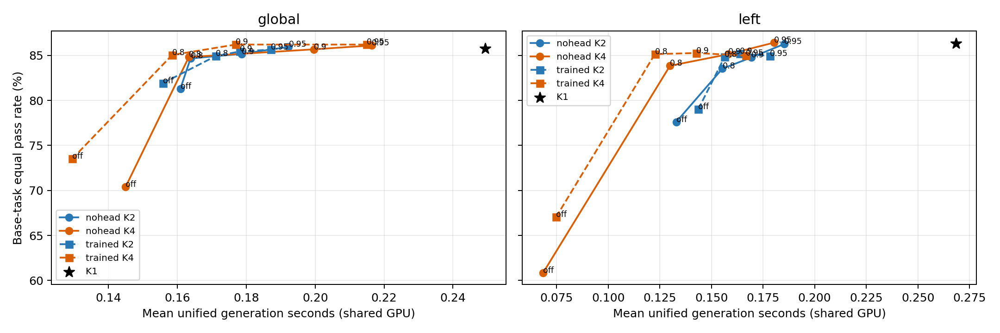
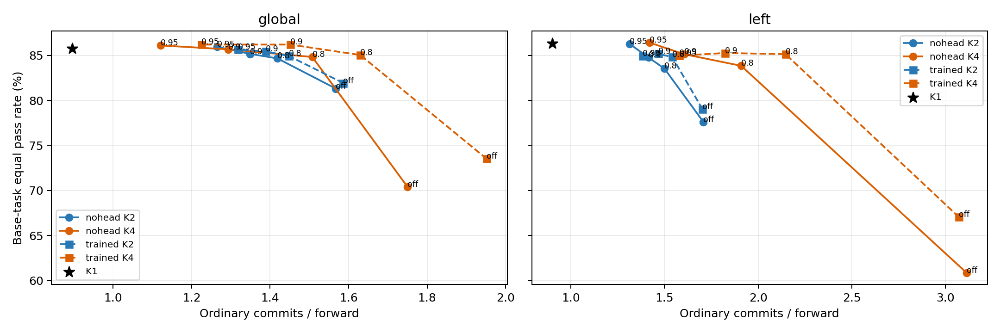

# DreamOn 阈值完整矩阵评测

状态：完整完成。质量生成 35122/35122，评分 35122/35122；计时 16728/16728。

起点 43a52fd；实际执行提交 `660f2960ff65fb216f762a1eca0183835de2afbb`。34配置、每配置1033唯一案例、164基础题；固定seed42、T=.2、top-p=.9、batch1、entropy/alg_temp0、mask64、steps256。DreamOn revision8ccc747，bf16；冻结rank256 v2 KL/full/best头float32、λ=1，sha256见run_spec。

阈值按完整合法词表T=1 FP32概率，对实际抽到的额外普通词判定；全轮首个空间候选唯一豁免。拒绝不重抽、不写入前驱，停止当前连续链；独立链首仍判阈值。原始扩删一次结束轮次，修正结构词保持屏障。共同随机键完全继承旧协议，不含本轮任务ID/方法/阈值/worker；分叉后不保证同坐标语义相同。

|配置|通过/1033|行均值%|基础题等权%|相对K1任务pp|普通提交/NFE|额外接受率|统一秒均值|K1时间比|
|---|---:|---:|---:|---:|---:|---:|---:|---:|
|global_k1_nohead_off|949/1033|91.87|85.74|0.00|0.90|未完成|0.25|1.00|
|global_k2_nohead_off|900/1033|87.12|81.31|-4.43|1.57|1.00|0.16|0.65|
|global_k2_nohead_080|938/1033|90.80|84.67|-1.07|1.42|0.73|0.16|0.66|
|global_k2_nohead_090|946/1033|91.58|85.17|-0.57|1.35|0.60|0.18|0.72|
|global_k2_nohead_095|952/1033|92.16|85.95|0.21|1.27|0.47|0.19|0.77|
|global_k2_trained_off|913/1033|88.38|81.93|-3.81|1.59|1.00|0.16|0.62|
|global_k2_trained_080|945/1033|91.48|84.93|-0.81|1.45|0.78|0.17|0.69|
|global_k2_trained_090|949/1033|91.87|85.44|-0.30|1.39|0.67|0.18|0.71|
|global_k2_trained_095|951/1033|92.06|85.65|-0.09|1.32|0.55|0.19|0.75|
|global_k4_nohead_off|820/1033|79.38|70.39|-15.35|1.75|1.00|0.14|0.58|
|global_k4_nohead_080|944/1033|91.38|84.82|-0.92|1.51|0.55|0.16|0.65|
|global_k4_nohead_090|949/1033|91.87|85.68|-0.06|1.29|0.40|0.20|0.80|
|global_k4_nohead_095|953/1033|92.26|86.10|0.36|1.12|0.31|0.22|0.87|
|global_k4_trained_off|842/1033|81.51|73.51|-12.23|1.95|1.00|0.13|0.52|
|global_k4_trained_080|950/1033|91.97|85.05|-0.69|1.63|0.66|0.16|0.64|
|global_k4_trained_090|955/1033|92.45|86.20|0.46|1.45|0.51|0.18|0.71|
|global_k4_trained_095|955/1033|92.45|86.20|0.46|1.23|0.40|0.21|0.86|
|left_k1_nohead_off|944/1033|91.38|86.31|0.00|0.90|未完成|0.27|1.00|
|left_k2_nohead_off|877/1033|84.90|77.62|-8.69|1.71|1.00|0.13|0.50|
|left_k2_nohead_080|923/1033|89.35|83.53|-2.78|1.50|0.71|0.16|0.58|
|left_k2_nohead_090|932/1033|90.22|84.78|-1.53|1.41|0.59|0.17|0.63|
|left_k2_nohead_095|939/1033|90.90|86.27|-0.04|1.31|0.45|0.19|0.69|
|left_k2_trained_off|899/1033|87.03|79.02|-7.29|1.70|1.00|0.14|0.54|
|left_k2_trained_080|933/1033|90.32|84.82|-1.49|1.54|0.77|0.16|0.58|
|left_k2_trained_090|936/1033|90.61|85.17|-1.14|1.47|0.66|0.16|0.61|
|left_k2_trained_095|936/1033|90.61|84.95|-1.36|1.38|0.54|0.18|0.66|
|left_k4_nohead_off|721/1033|69.80|60.83|-25.48|3.11|1.00|0.07|0.25|
|left_k4_nohead_080|928/1033|89.84|83.85|-2.46|1.91|0.58|0.13|0.48|
|left_k4_nohead_090|937/1033|90.71|85.13|-1.18|1.61|0.44|0.16|0.59|
|left_k4_nohead_095|942/1033|91.19|86.42|0.11|1.42|0.35|0.18|0.67|
|left_k4_trained_off|783/1033|75.80|67.04|-19.27|3.07|1.00|0.07|0.28|
|left_k4_trained_080|933/1033|90.32|85.14|-1.17|2.15|0.70|0.12|0.46|
|left_k4_trained_090|938/1033|90.80|85.27|-1.04|1.82|0.56|0.14|0.53|
|left_k4_trained_095|937/1033|90.71|84.97|-1.34|1.58|0.44|0.17|0.62|

普通提交统计排除结构与no-op。部分状态的通过率只描述已评分人口；不得当成1033全量率。逐例输出、token、NFE、结构计数、额外词接受拒绝、提交分布、显存与耗时见per_case.jsonl.gz。计时重跑另见timing_per_case.jsonl.gz，不计新质量样本。

配对比较：summary.csv列出每配置相对对应K1、同方法off、同阈值另一方法的行和题均值差。paired_comparisons.csv保存逐例救回/改错/净变化和整道基础题bootstrap95%区间（10000次，seed20261104）；每次重采样164题并保留题内全部行。不能把1033行当独立题。

## 预设问题的实测判断
- global K2 无头：已测阈值中题均值最高点为0.95，相对off 4.64pp，恢复K1差距比例1.05，普通提交/NFE从1.57降至1.27；其质量相对K1 0.21pp。此为事后描述最佳点，完整负结果仍在表中。
- global K4 无头：已测阈值中题均值最高点为0.95，相对off 15.72pp，恢复K1差距比例1.02，普通提交/NFE从1.75降至1.12；其质量相对K1 0.36pp。此为事后描述最佳点，完整负结果仍在表中。
- left K2 无头：已测阈值中题均值最高点为0.95，相对off 8.65pp，恢复K1差距比例1.00，普通提交/NFE从1.71降至1.31；其质量相对K1 -0.04pp。此为事后描述最佳点，完整负结果仍在表中。
- left K4 无头：已测阈值中题均值最高点为0.95，相对off 25.59pp，恢复K1差距比例1.00，普通提交/NFE从3.11降至1.42；其质量相对K1 0.11pp。此为事后描述最佳点，完整负结果仍在表中。
- global_k2_trained_off − 无头同阈值：救回17、改错4、净+13，题均值0.62pp，95%区间[-1.0416607043291894, 1.8864986772961738]。
- global_k2_trained_080 − 无头同阈值：救回9、改错2、净+7，题均值0.26pp，95%区间[-0.31312257222879814, 0.7505943680125322]。
- global_k2_trained_090 − 无头同阈值：救回5、改错2、净+3，题均值0.27pp，95%区间[-0.3116674724505276, 1.068697068336028]。
- global_k2_trained_095 − 无头同阈值：救回0、改错1、净-1，题均值-0.30pp，95%区间[-0.9146341463414634, 0.0]。
- global_k4_trained_off − 无头同阈值：救回32、改错10、净+22，题均值3.13pp，95%区间[1.1534070773860683, 5.451366280189152]。
- global_k4_trained_080 − 无头同阈值：救回10、改错4、净+6，题均值0.23pp，95%区间[-1.6287659975882054, 1.9991566387185766]。
- global_k4_trained_090 − 无头同阈值：救回8、改错2、净+6，题均值0.53pp，95%区间[0.04183259909752212, 1.300005936288429]。
- global_k4_trained_095 − 无头同阈值：救回3、改错1、净+2，题均值0.10pp，95%区间[-0.17421602787456447, 0.3847270615563298]。
- left_k2_trained_off − 无头同阈值：救回32、改错10、净+22，题均值1.41pp，95%区间[-0.6738229188084773, 3.483341563051126]。
- left_k2_trained_080 − 无头同阈值：救回14、改错4、净+10，题均值1.29pp，95%区间[0.0011431479659977995, 2.9379019657421446]。
- left_k2_trained_090 − 无头同阈值：救回7、改错3、净+4，题均值0.39pp，95%区间[-1.4449429613294649, 2.2441040227202302]。
- left_k2_trained_095 − 无头同阈值：救回1、改错4、净-3，题均值-1.32pp，95%区间[-3.1984510793383794, -0.01822259601906364]。
- left_k4_trained_off − 无头同阈值：救回80、改错18、净+62，题均值6.20pp，95%区间[3.8151748042281053, 8.879970225694876]。
- left_k4_trained_080 − 无头同阈值：救回15、改错10、净+5，题均值1.29pp，95%区间[-0.48230566368804495, 3.4777038679477705]。
- left_k4_trained_090 − 无头同阈值：救回8、改错7、净+1，题均值0.14pp，95%区间[-1.7431661951409858, 2.026449444041073]。
- left_k4_trained_095 − 无头同阈值：救回2、改错7、净-5，题均值-1.45pp，95%区间[-3.3849520564591002, -0.08570140231462779]。

预设工程标记（题均值相对K1下降≤1pp且统一总生成时间减少≥20%）的观察候选：global_k2_nohead_090, global_k2_nohead_095, global_k2_trained_080, global_k2_trained_090, global_k2_trained_095, global_k4_nohead_080, global_k4_trained_080, global_k4_trained_090, left_k2_nohead_095, left_k4_nohead_095。当前为非独占共享H200，存在争用时不作确定达标判断；无候选时也不以未完成计时代替否定结论。

相近质量的跨方法时间比较见nearest_quality.csv：同选位内寻找已测题均值距离最小的另一方法配置，报告实际质量差和时间比；属于事后描述，不假定置信度已校准。

计时为164基础题各固定1例×34配置×3次，配置按case/repetition稳定轮换。每次恢复先对所有配置预热；cuda同步边界包含主模型、头、阈值、选位、共同采样及结构操作，排除模型加载、官方代码测试、写盘与重型轨迹。质量阶段两个模型并发的耗时仅作负载观测。外部GPU进程和显存每30秒记录，摘要见timing_environment.json；不声称独占公平测速。

本轮为单seed、反复使用开发题的探索评测。没有打开封存external test，没有训练或换头，没有教师重算/KV缓存/多行/K8/新阈值；历史951/817/831等结果不混入配对。不能宣称独立验证、正确率保证或方法新颖性。

完整性、缺失、重复、异常、版本混用和计时输出分歧见integrity_audit.json；所有基础设施尝试见attempts.json。普通失败/3秒超时原样保留；无按结果补抽。reviewer_gate_disabled：本地diff review + fresh CPU/GPU技术检查，未有独立reviewer。

恢复入口：见resume.md；共享状态和角色锁位于run_spec指定目录；大日志和权重不进普通git。
