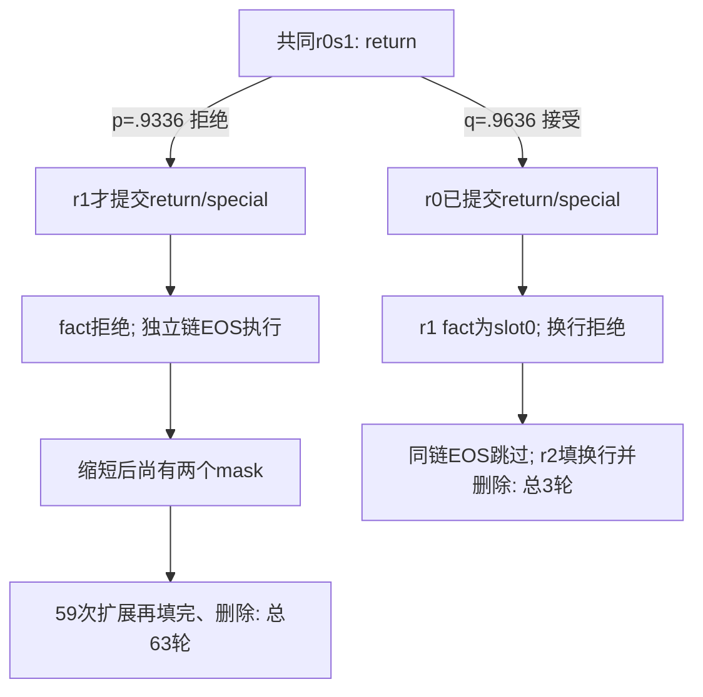

# 焦点案例与质量翻转专项

主生成、分叉、从头种子已完成；未修改原入口的全量详细字段复核仍在进行，最终验收见 delivery_verification.json。NH/H 表示无头/旧冻结头。剩余NFE不计当前轮已经发生的主前向，不重新获得轮次或扩展预算。所有配对延续使用种子42—49，当前候选固定为历史u，不等于八次从头生成。

## 139/L5：首个评分跨阈值是已验证的原因

六配置都生成同一串五词元 `    return special_fact\n`，全部通过。K2 NH .90/.95 都是4次前向、零扩展；K4 NH .90是3/0，NH .95是63/59；K4 H .90/.95都是3/0。有头 .95 共四次事实调用，候选四次都没有变化。各行从各自的事实快照出发，不能相加。

|事实调用|位置、候选|p→q，阈值.95|PP/QP余NFE|PQ/QQ余NFE|八种子结果|
|---|---|---|---:|---:|---|
|r0 s1|133，` return`|.933616→.963579，拒绝→接受|62，扩展59|2，扩展0|只改当前评分即可省60次，均通过、同词元|
|r0 s2|134，` special`|.956832→.969347，均接受|2|2|单次取消无生成效果|
|r0 s3|135，`_fact`|.344012→.369390，均拒绝|2|2|单次取消无生成效果|
|r1 s1|136，换行|.721747→.837994，均拒绝|1|1|单次取消无生成效果|

四调用×四组×八种子共128条，全部通过、最终词元完全相同。首调用的完整总成本为63→3。反向验证在无头r0 s1的完整同一调用前状态进行：只在本次加头，以后继续无头，PQ/QQ仍余2、零扩展；PP/QP余62、59扩展，八种子全通过。张量、暂存提交、拒绝状态、游标、记忆和预算逐项相等，所以这是同状态干预。首次扩展前最后一个合格状态为无头r1 s2，四组均余61、扩展59：迟到的单次修正没有救回长路径。

### 真实轨迹与中介解释的边界

前缀长132，补全占132—136，EOS在137。无头首轮只提交空格，return被拒绝，special/fact因同链传播跳过。有头首轮已放行return和special。无头第二轮K4选 `[133,134,135,137]`，空间链 `[0,0,0,1]`：return/special提交，fact拒绝；独立链的原生EOS仍执行，删59位置，待填区64→5，而fact/换行仍是mask。下一轮短画布提出EXPAND，连续扩展59次，再填普通词并删59位置。K2同轮只选 `[133,134]`，未抵达EOS，走4轮短路。

有头第二轮选 `[135,136,137,138]`，属于同一空间链：fact是原空间slot0，免阈值提交；换行拒绝，同链EOS被跳过。第三轮换行成为slot0，随后正常删除，3轮结束。

评分跨阈值的路径总效应已被干预确认；“必须跳过这次EOS才变短”没有单独证明。.90无头取消一次拒绝传播会让EOS提前执行，却仍3轮、同词元、同质量。删除终点5本身与正确答案长度一致；问题在于删除时普通前缀尚未完成，后续短画布又提出扩展，不能笼统称为EOS长度预测错。

### 139规则分叉

下面所有分支八种子均通过，最终词元与事实路径完全相同。

|阈值/第一次事件|原余NFE|仅延后|仅否决/取消一次传播|解释|
|---|---:|---:|---:|---|
|.95 拒绝传播|62|—|3|本词仍拒绝，继续检查后词；总63→4，扩展59→0|
|.95 删除|61|2|2|此前普通提交落盘、保留长画布再判断；总63→4|
|.95 扩展|60|61|1|延后只多一轮；否决改选普通词，总63→4|
|.90 拒绝传播|1|—|1|动作时序变化，成本、质量不变|
|.90 删除|0|1|1|原删除已安全，延后多花一轮|
|.90 扩展|—|—|—|事实无扩展，不适用|

否决 .95 首次EXPAND时，同一u重抽到 `_fact`，仍用干预前概率.240127判阈值。它是原空间slot0，获豁免；后续换行概率.671999被拒绝，下一轮成为slot0才提交。不是归一化抬分、选择参考答案或无代价删掉扩展。延后EXPAND时无暂存普通提交改变画布，下一轮强扩展选择回来，所以只额外花一轮。

## 126/L0：早期删除影响质量，扩展数没有减少

seed42：K2 NH .90/.95为15/17轮、零扩展、均通过；K4 NH .90/.95为73/71轮、均扩展64次并失败；H .90为73轮失败，H .95为78轮通过且仍扩展64次。无头错误输出为 `    count_digit = {}\n   ` 一类；H .95另外生成 `    count_digit = dict.fromkeys(lst, 0)\n`。这是质量改善付出更多前向，不能只报效率。

首次拒绝传播干预没有效果；首次扩展延后/否决仍用完64次扩展、八种子都失败。首次删除干预才将两个阈值的原始失败分支全部救回：

|阈值|原规则余NFE/通过|延后和否决余NFE/通过|配对增加成本|扩展数|
|---|---|---|---|---:|
|.90|68或71，0/8|75，8/8|+4或+7|双方均64|
|.95|68或71，0/8|76，8/8|+5或+8|双方均64|

因而删除时机对后续代码质量有可验证影响，即使扩展总数完全不变。更便宜的原失败不是优势。

## 80/L5：必要的普通生成，与头的并行放行

|配置|R|O|S|Z|扩展|通过|
|---|---:|---:|---:|---:|---:|---|
|K2 NH .90|18|23|6|1|0|否|
|K2 NH .95|19|23|5|1|0|否|
|K4 NH .90|38|37|5|6|12|是|
|K4 H .90|30|37|12|5|12|是|
|K4 NH .95|41|37|2|6|12|是|
|K4 H .95|35|37|8|6|12|是|

K2只生成 `if s[i] == s[i + 1] or s[i] == s[i + 2]:`，K4正确补上 `or s[i + 1] == s[i + 2]`。多14个普通词元对应必要代码，K4多前向不能全部叫浪费。加头后O不变，.95的6次节省完全对应S增6；.90的8次对应S增7、Z减1。扩展可能与普通提交在同轮，扩展数不等于Z。

首次拒绝传播干预无效果。首次删除延后/否决：.90余32→11、.95余34→11，扩展12→0，但两个阈值都是8/8通过→0/8通过，不能叫改善。首次扩展延后/否决：.90变5/8通过，.95变7/8通过（原规则均8/8）；成功分支多花2轮，失败分支更便宜，反对直接部署统一结构禁令。

## 顺序/唯一免阈值位置：六条不适用

三个焦点×两个阈值均不存在预定条件 `a2!=a4 && a2 in S4` 的轮次，六条N/A保留，没有追逐其他事件。因此没有直接识别顺序和豁免位置各自的因果效果。slot0作用有实际轨迹支持，但不等于完成2×2分解；非单调拒绝链集合已通过合成测试及原空间顺序与历史标量实现的等价检查。

## 十个质量翻转：首次不同动作不等于全部质量原因

历史 .90八救回、两改错全复现；十处首次不同实际动作均是同词跨阈值，完整调用前状态均匹配。PP是在有头宿主上只取消当前调用、后面仍有头，不能当作全无头。T/F串按延续seed42—49，QP=PP、QQ=PQ仅指生成和质量。

|案例|历史NH→H|PP通过串→QQ通过串|QQ−PP余NFE|解释|
|---|---|---|---|---|
|105/L16|F→T|FFFFFFFF→TTTTTTTT|全+1|稳定救回、付出1轮，本次是降分拒绝|
|109/L8|F→T|TTTTTTTT→TTTTTTTT|全−1|取消首差异仍通过，不能归因完整救回|
|114/L4|F→T|FTTTTTTT→TTFTTTTT|全−1|42救回，44改错|
|140/L16|F→T|TTTTTTTT→TTTTTTTT|全−1|本次只验证节省，未验证质量原因|
|32/L4|T→F|TFFFFFFF→FFFTFFFF|10,−1,1,3,−1,−1,−1,−1|42改错，45救回|
|32/L5|F→T|TTTTTTTT→TTTTTTTT|全0|未来调用可能补偿，当前单次无效|
|37/L2|F→T|FFFFFFFF→TTTTTTTT|全−2|稳定救回、节省2轮|
|6/L0|T→F|TFFFFFFT→FFFFFFFF|−14,−50,−50,−11,0,0,0,−15|42、49损害，其余双方都失败|
|66/L1|F→T|TTTTTTTT→TTTTTTTT|全0|不能从当前单次无效推到全头无效|
|99/L7|F→T|FTTTTTTT→TTTTFFTT|−6,1,−1,−8,4,−4,6,−7|42救回，46/47改错，成本方向亦不稳|

105/L16的r1 s1 `:\n` 从.926290降到.721205，.90接受变拒绝，本次救回8/8，反对头只是统一提高置信度。32/L4空格 .842416→.923733、6/L0 ` ->` .841556→.901100 则升分放行却改错。单次取消无质量影响可能源于后续补偿、冗余或路径交互；未做多调用开关搜索，不能宣布整个头无用或相加各次效果。

## 从头seed43—45与条件延续分开

54条额外从头生成全部完成，无残mask。139和80的六配置在三个新种子下NFE、扩展、输出和通过结果与历史完全相同。126：K2两阈值均15/17轮通过；K4 NH .90和H .90均70轮失败；NH .95为71/74/74轮均失败，H .95均78轮通过。126错误代码和具体成本会变化，K4无头高成本失败及 .95有头救回的方向稳定。这是三个病例×三个种子的有限证据，不能推广为总体稳定性结论。114、32/L4、99的条件延续反向效果均保留。

## 逐轮证据附录（自动导出）

所有轮次/slot均从0开始。单次干预效果不能相加；共同状态由完整控制状态、logits、hidden逐项比对。

## SingleLineInfilling/HumanEval/139/L5

|配置|seed|NFE|头|扩展|删除位置|通过|残mask|
|---|---:|---:|---:|---:|---:|---|---:|
|global_k2_nohead_090|42|4|0|0|59|True|0|
|global_k2_nohead_095|42|4|0|0|59|True|0|
|global_k4_nohead_090|42|3|0|0|59|True|0|
|global_k4_nohead_095|42|63|0|59|118|True|0|
|global_k4_trained_090|42|3|4|0|59|True|0|
|global_k4_trained_095|42|3|4|0|59|True|0|
|global_k2_nohead_090|43|4|0|0|59|True|0|
|global_k2_nohead_090|44|4|0|0|59|True|0|
|global_k2_nohead_090|45|4|0|0|59|True|0|
|global_k2_nohead_095|43|4|0|0|59|True|0|
|global_k2_nohead_095|44|4|0|0|59|True|0|
|global_k2_nohead_095|45|4|0|0|59|True|0|
|global_k4_nohead_090|43|3|0|0|59|True|0|
|global_k4_nohead_090|44|3|0|0|59|True|0|
|global_k4_nohead_090|45|3|0|0|59|True|0|
|global_k4_nohead_095|43|63|0|59|118|True|0|
|global_k4_nohead_095|44|63|0|59|118|True|0|
|global_k4_nohead_095|45|63|0|59|118|True|0|
|global_k4_trained_090|43|3|4|0|59|True|0|
|global_k4_trained_090|44|3|4|0|59|True|0|
|global_k4_trained_090|45|3|4|0|59|True|0|
|global_k4_trained_095|43|3|4|0|59|True|0|
|global_k4_trained_095|44|3|4|0|59|True|0|
|global_k4_trained_095|45|3|4|0|59|True|0|

干预结果（seed42；其它配对延续见fork_per_case与continuation_stability）：

|分组/状态|干预|余NFE|余头|余扩展|余删除位置|通过|残mask|
|---|---|---:|---:|---:|---:|---|---:|
|139_common_reverse/head/r0s1|PP|62|0|59|118|True|0|
|139_common_reverse/head/r0s1|PQ|2|1|0|59|True|0|
|139_common_reverse/head/r0s1|QP|62|1|59|118|True|0|
|139_common_reverse/head/r0s1|QQ|2|1|0|59|True|0|
|139_factual_head/head/r0s1|PP|62|3|59|118|True|0|
|139_factual_head/head/r0s1|PQ|2|4|0|59|True|0|
|139_factual_head/head/r0s1|QP|62|4|59|118|True|0|
|139_factual_head/head/r0s1|QQ|2|4|0|59|True|0|
|139_factual_head/head/r0s2|PP|2|2|0|59|True|0|
|139_factual_head/head/r0s2|PQ|2|3|0|59|True|0|
|139_factual_head/head/r0s2|QP|2|3|0|59|True|0|
|139_factual_head/head/r0s2|QQ|2|3|0|59|True|0|
|139_factual_head/head/r0s3|PP|2|1|0|59|True|0|
|139_factual_head/head/r0s3|PQ|2|2|0|59|True|0|
|139_factual_head/head/r0s3|QP|2|2|0|59|True|0|
|139_factual_head/head/r0s3|QQ|2|2|0|59|True|0|
|139_factual_head/head/r1s1|PP|1|0|0|59|True|0|
|139_factual_head/head/r1s1|PQ|1|1|0|59|True|0|
|139_factual_head/head/r1s1|QP|1|1|0|59|True|0|
|139_factual_head/head/r1s1|QQ|1|1|0|59|True|0|
|139_pre_expand/head/r1s2|PP|61|0|59|118|True|0|
|139_pre_expand/head/r1s2|PQ|61|1|59|118|True|0|
|139_pre_expand/head/r1s2|QP|61|1|59|118|True|0|
|139_pre_expand/head/r1s2|QQ|61|1|59|118|True|0|
|decoder/delete/r2s1|defer|1|0|0|59|True|0|
|decoder/delete/r2s1|original|0|0|0|59|True|0|
|decoder/delete/r2s1|veto|1|0|0|59|True|0|
|decoder/delete/r1s3|defer|2|0|0|59|True|0|
|decoder/delete/r1s3|original|61|0|59|118|True|0|
|decoder/delete/r1s3|veto|2|0|0|59|True|0|
|decoder/expand/r2s0|defer|61|0|59|59|True|0|
|decoder/expand/r2s0|original|60|0|59|59|True|0|
|decoder/expand/r2s0|veto|1|0|0|0|True|0|
|decoder/no_propagation/r1s1|no_propagation|1|0|0|59|True|0|
|decoder/no_propagation/r1s1|original|1|0|0|59|True|0|
|decoder/no_propagation/r0s1|no_propagation|3|0|0|59|True|0|
|decoder/no_propagation/r0s1|original|62|0|59|118|True|0|

## SingleLineInfilling/HumanEval/126/L0

|配置|seed|NFE|头|扩展|删除位置|通过|残mask|
|---|---:|---:|---:|---:|---:|---|---:|
|global_k2_nohead_090|42|15|0|0|44|True|0|
|global_k2_nohead_095|42|17|0|0|44|True|0|
|global_k4_nohead_090|42|73|0|64|119|False|0|
|global_k4_nohead_095|42|71|0|64|122|False|0|
|global_k4_trained_090|42|73|7|64|119|False|0|
|global_k4_trained_095|42|78|11|64|111|True|0|
|global_k2_nohead_090|43|15|0|0|44|True|0|
|global_k2_nohead_090|44|15|0|0|44|True|0|
|global_k2_nohead_090|45|15|0|0|44|True|0|
|global_k2_nohead_095|43|17|0|0|44|True|0|
|global_k2_nohead_095|44|17|0|0|44|True|0|
|global_k2_nohead_095|45|17|0|0|44|True|0|
|global_k4_nohead_090|43|70|0|64|122|False|0|
|global_k4_nohead_090|44|70|0|64|122|False|0|
|global_k4_nohead_090|45|70|0|64|122|False|0|
|global_k4_nohead_095|43|71|0|64|122|False|0|
|global_k4_nohead_095|44|74|0|64|119|False|0|
|global_k4_nohead_095|45|74|0|64|119|False|0|
|global_k4_trained_090|43|70|4|64|122|False|0|
|global_k4_trained_090|44|70|4|64|122|False|0|
|global_k4_trained_090|45|70|4|64|122|False|0|
|global_k4_trained_095|43|78|11|64|111|True|0|
|global_k4_trained_095|44|78|11|64|111|True|0|
|global_k4_trained_095|45|78|11|64|111|True|0|

干预结果（seed42；其它配对延续见fork_per_case与continuation_stability）：

|分组/状态|干预|余NFE|余头|余扩展|余删除位置|通过|残mask|
|---|---|---:|---:|---:|---:|---|---:|
|decoder/delete/r1s3|defer|75|0|64|111|True|0|
|decoder/delete/r1s3|original|71|0|64|119|False|0|
|decoder/delete/r1s3|veto|75|0|64|111|True|0|
|decoder/delete/r2s3|defer|76|0|64|111|True|0|
|decoder/delete/r2s3|original|68|0|64|122|False|0|
|decoder/delete/r2s3|veto|76|0|64|111|True|0|
|decoder/expand/r2s1|defer|68|0|64|70|False|0|
|decoder/expand/r2s1|original|70|0|64|67|False|0|
|decoder/expand/r2s1|veto|71|0|64|66|False|0|
|decoder/expand/r3s1|defer|68|0|64|70|False|0|
|decoder/expand/r3s1|original|67|0|64|70|False|0|
|decoder/expand/r3s1|veto|68|0|64|70|False|0|
|decoder/no_propagation/r0s2|no_propagation|72|0|64|119|False|0|
|decoder/no_propagation/r0s2|original|72|0|64|119|False|0|
|decoder/no_propagation/r0s1|no_propagation|70|0|64|122|False|0|
|decoder/no_propagation/r0s1|original|70|0|64|122|False|0|

## SingleLineInfilling/HumanEval/80/L5

|配置|seed|NFE|头|扩展|删除位置|通过|残mask|
|---|---:|---:|---:|---:|---:|---|---:|
|global_k2_nohead_090|42|18|0|0|41|False|0|
|global_k2_nohead_095|42|19|0|0|41|False|0|
|global_k4_nohead_090|42|38|0|12|39|True|0|
|global_k4_nohead_095|42|41|0|12|39|True|0|
|global_k4_trained_090|42|30|23|12|39|True|0|
|global_k4_trained_095|42|35|24|12|39|True|0|
|global_k2_nohead_090|43|18|0|0|41|False|0|
|global_k2_nohead_090|44|18|0|0|41|False|0|
|global_k2_nohead_090|45|18|0|0|41|False|0|
|global_k2_nohead_095|43|19|0|0|41|False|0|
|global_k2_nohead_095|44|19|0|0|41|False|0|
|global_k2_nohead_095|45|19|0|0|41|False|0|
|global_k4_nohead_090|43|38|0|12|39|True|0|
|global_k4_nohead_090|44|38|0|12|39|True|0|
|global_k4_nohead_090|45|38|0|12|39|True|0|
|global_k4_nohead_095|43|41|0|12|39|True|0|
|global_k4_nohead_095|44|41|0|12|39|True|0|
|global_k4_nohead_095|45|41|0|12|39|True|0|
|global_k4_trained_090|43|30|23|12|39|True|0|
|global_k4_trained_090|44|30|23|12|39|True|0|
|global_k4_trained_090|45|30|23|12|39|True|0|
|global_k4_trained_095|43|35|24|12|39|True|0|
|global_k4_trained_095|44|35|24|12|39|True|0|
|global_k4_trained_095|45|35|24|12|39|True|0|

干预结果（seed42；其它配对延续见fork_per_case与continuation_stability）：

|分组/状态|干预|余NFE|余头|余扩展|余删除位置|通过|残mask|
|---|---|---:|---:|---:|---:|---|---:|
|decoder/delete/r5s3|defer|11|0|0|41|False|0|
|decoder/delete/r5s3|original|32|0|12|39|True|0|
|decoder/delete/r5s3|veto|11|0|0|41|False|0|
|decoder/delete/r6s3|defer|11|0|0|41|False|0|
|decoder/delete/r6s3|original|34|0|12|39|True|0|
|decoder/delete/r6s3|veto|11|0|0|41|False|0|
|decoder/expand/r11s1|defer|28|0|12|1|True|0|
|decoder/expand/r11s1|original|26|0|12|1|True|0|
|decoder/expand/r11s1|veto|28|0|12|1|True|0|
|decoder/expand/r12s1|defer|30|0|12|1|True|0|
|decoder/expand/r12s1|original|28|0|12|1|True|0|
|decoder/expand/r12s1|veto|30|0|12|1|True|0|
|decoder/no_propagation/r1s1|no_propagation|36|0|12|39|True|0|
|decoder/no_propagation/r1s1|original|36|0|12|39|True|0|
|decoder/no_propagation/r0s1|no_propagation|40|0|12|39|True|0|
|decoder/no_propagation/r0s1|original|40|0|12|39|True|0|

## K4 .90全部质量翻转

SingleLineInfilling/HumanEval/105/L16：无头False→有头True。

global_k4_nohead_090：
- r0：选[376, 377, 378, 379]，普通提交2，扩展[]，删除[]；s0 286→286 exempt p=None；s1 3650→3650 ordinary_accepted p=0.9963551759719849；s2 510→510 threshold_rejected p=0.70673668384552；s3 None→None chain_skipped p=None
- r1：选[378, 379, 380, 381]，普通提交2，扩展[]，删除[380, 381, 382, 383, 384, 385, 386, 387, 388, 389, 390, 391, 392, 393, 394, 395, 396, 397, 398, 399, 400, 401, 402, 403, 404, 405, 406, 407, 408, 409, 410, 411, 412, 413, 414, 415, 416, 417, 418, 419, 420, 421, 422, 423, 424, 425, 426, 427, 428, 429, 430, 431, 432, 433, 434, 435, 436, 437, 438, 439]；s0 510→510 exempt p=None；s1 510→510 ordinary_accepted p=0.9262900948524475；s2 151643→151643 base_structure p=None；s3 None→None barrier_unreached p=None
global_k4_trained_090：
- r0：选[376, 377, 378, 379]，普通提交2，扩展[]，删除[]；s0 286→286 exempt p=None；s1 3650→3650 ordinary_accepted p=0.9958236217498779；s2 510→510 threshold_rejected p=0.6500476002693176；s3 None→None chain_skipped p=None
- r1：选[378, 379, 380, 381]，普通提交1，扩展[]，删除[]；s0 510→510 exempt p=None；s1 510→510 threshold_rejected p=0.7212053537368774；s2 None→None chain_skipped p=None；s3 None→None chain_skipped p=None
- r2：选[379, 380, 381, 382]，普通提交0，扩展[]，删除[379, 380, 381, 382, 383, 384, 385, 386, 387, 388, 389, 390, 391, 392, 393, 394, 395, 396, 397, 398, 399, 400, 401, 402, 403, 404, 405, 406, 407, 408, 409, 410, 411, 412, 413, 414, 415, 416, 417, 418, 419, 420, 421, 422, 423, 424, 425, 426, 427, 428, 429, 430, 431, 432, 433, 434, 435, 436, 437, 438, 439]；s0 151643→151643 base_structure p=None；s1 None→None barrier_unreached p=None；s2 None→None barrier_unreached p=None；s3 None→None barrier_unreached p=None

SingleLineInfilling/HumanEval/109/L8：无头False→有头True。

global_k4_nohead_090：
- r0：选[349, 350, 352, 353]，普通提交1，扩展[]，删除[]；s0 262→262 exempt p=None；s1 600→600 threshold_rejected p=0.5300914645195007；s2 2088→2088 threshold_rejected p=0.45745372772216797；s3 None→None chain_skipped p=None
- r1：选[348, 350, 351, 352]，普通提交3，扩展[]，删除[]；s0 1066→1066 exempt p=None；s1 369→369 ordinary_accepted p=0.9928542971611023；s2 600→600 ordinary_accepted p=0.9600780606269836；s3 304→304 threshold_rejected p=0.7830325961112976
- r2：选[352, 353, 354, 356]，普通提交2，扩展[]，删除[]；s0 304→304 exempt p=None；s1 2088→2088 ordinary_accepted p=0.9493483304977417；s2 6901→6901 threshold_rejected p=0.750386118888855；s3 9957→9957 threshold_rejected p=0.7039905786514282
- r3：选[354, 356, 357, 358]，普通提交1，扩展[]，删除[]；s0 6901→6901 exempt p=None；s1 9957→9957 threshold_rejected p=0.5790513753890991；s2 None→None chain_skipped p=None；s3 None→None chain_skipped p=None
- r4：选[356, 357, 358, 359]，普通提交2，扩展[]，删除[358, 359, 360, 361, 362, 363, 364, 365, 366, 367, 368, 369, 370, 371, 372, 373, 374, 375, 376, 377, 378, 379, 380, 381, 382, 383, 384, 385, 386, 387, 388, 389, 390, 391, 392, 393, 394, 395, 396, 397, 398, 399, 400, 401, 402, 403, 404, 405, 406, 407, 408, 409, 410, 411]；s0 9957→9957 exempt p=None；s1 9957→9957 ordinary_accepted p=0.9286763668060303；s2 151643→151643 base_structure p=None；s3 None→None barrier_unreached p=None
- r5：选[355]，普通提交1，扩展[]，删除[]；s0 10939→10939 exempt p=None
global_k4_trained_090：
- r0：选[349, 350, 352, 353]，普通提交1，扩展[]，删除[]；s0 262→262 exempt p=None；s1 600→600 threshold_rejected p=0.5685140490531921；s2 2088→2088 threshold_rejected p=0.45745372772216797；s3 None→None chain_skipped p=None
- r1：选[348, 350, 351, 352]，普通提交4，扩展[]，删除[]；s0 1066→1066 exempt p=None；s1 369→369 ordinary_accepted p=0.9928542971611023；s2 600→600 ordinary_accepted p=0.9905445575714111；s3 304→304 ordinary_accepted p=0.9622355699539185
- r2：选[353, 354, 355, 356]，普通提交2，扩展[]，删除[]；s0 2088→2088 exempt p=None；s1 6901→6901 ordinary_accepted p=0.9430444836616516；s2 10939→10939 threshold_rejected p=0.6905263066291809；s3 None→None chain_skipped p=None
- r3：选[356, 357, 358, 359]，普通提交1，扩展[]，删除[]；s0 9957→9957 exempt p=None；s1 9957→9957 threshold_rejected p=0.5179309248924255；s2 None→None chain_skipped p=None；s3 None→None chain_skipped p=None
- r4：选[355, 357, 358, 359]，普通提交1，扩展[]，删除[357, 358, 359, 360, 361, 362, 363, 364, 365, 366, 367, 368, 369, 370, 371, 372, 373, 374, 375, 376, 377, 378, 379, 380, 381, 382, 383, 384, 385, 386, 387, 388, 389, 390, 391, 392, 393, 394, 395, 396, 397, 398, 399, 400, 401, 402, 403, 404, 405, 406, 407, 408, 409, 410, 411]；s0 10939→10939 exempt p=None；s1 151643→151643 base_structure p=None；s2 None→None barrier_unreached p=None；s3 None→None barrier_unreached p=None

SingleLineInfilling/HumanEval/114/L4：无头False→有头True。

global_k4_nohead_090：
- r0：选[109, 110, 111, 112]，普通提交2，扩展[]，删除[]；s0 286→286 exempt p=None；s1 421→421 ordinary_accepted p=0.9964830875396729；s2 274→274 threshold_rejected p=0.8948380351066589；s3 None→None chain_skipped p=None
- r1：选[111, 113, 114, 115]，普通提交1，扩展[]，删除[]；s0 274→274 exempt p=None；s1 220→220 threshold_rejected p=0.7201688885688782；s2 None→None chain_skipped p=None；s3 None→None chain_skipped p=None
- r2：选[113, 114, 115, 116]，普通提交1，扩展[]，删除[]；s0 220→220 exempt p=None；s1 15→15 threshold_rejected p=0.8284781575202942；s2 None→None chain_skipped p=None；s3 None→None chain_skipped p=None
- r3：选[112, 114, 115, 116]，普通提交3，扩展[]，删除[116, 117, 118, 119, 120, 121, 122, 123, 124, 125, 126, 127, 128, 129, 130, 131, 132, 133, 134, 135, 136, 137, 138, 139, 140, 141, 142, 143, 144, 145, 146, 147, 148, 149, 150, 151, 152, 153, 154, 155, 156, 157, 158, 159, 160, 161, 162, 163, 164, 165, 166, 167, 168, 169, 170, 171, 172]；s0 861→861 exempt p=None；s1 15→15 ordinary_accepted p=0.9957719445228577；s2 510→510 ordinary_accepted p=0.9941238760948181；s3 151643→151643 base_structure p=None
global_k4_trained_090：
- r0：选[109, 110, 111, 112]，普通提交3，扩展[]，删除[]；s0 286→286 exempt p=None；s1 421→421 ordinary_accepted p=0.9972301125526428；s2 274→274 ordinary_accepted p=0.9351577162742615；s3 366→366 threshold_rejected p=0.6319135427474976
- r1：选[113, 114, 115, 116]，普通提交3，扩展[]，删除[116, 117, 118, 119, 120, 121, 122, 123, 124, 125, 126, 127, 128, 129, 130, 131, 132, 133, 134, 135, 136, 137, 138, 139, 140, 141, 142, 143, 144, 145, 146, 147, 148, 149, 150, 151, 152, 153, 154, 155, 156, 157, 158, 159, 160, 161, 162, 163, 164, 165, 166, 167, 168, 169, 170, 171, 172]；s0 220→220 exempt p=None；s1 15→15 ordinary_accepted p=0.9904834032058716；s2 510→510 ordinary_accepted p=0.9863660335540771；s3 151643→151643 base_structure p=None
- r2：选[112]，普通提交1，扩展[]，删除[]；s0 366→366 exempt p=None

SingleLineInfilling/HumanEval/140/L16：无头False→有头True。

global_k4_nohead_090：
- r0：选[226, 227, 228, 229]，普通提交3，扩展[]，删除[]；s0 286→286 exempt p=None；s1 501→501 ordinary_accepted p=0.9865522980690002；s2 4326→4326 ordinary_accepted p=0.9895303249359131；s3 1421→1421 threshold_rejected p=0.6987796425819397
- r1：选[229, 230, 231, 232]，普通提交1，扩展[]，删除[]；s0 1421→1421 exempt p=None；s1 67773→67773 threshold_rejected p=0.8823733925819397；s2 None→None chain_skipped p=None；s3 None→None chain_skipped p=None
- r2：选[230, 231, 232, 233]，普通提交2，扩展[]，删除[232, 233, 234, 235, 236, 237, 238, 239, 240, 241, 242, 243, 244, 245, 246, 247, 248, 249, 250, 251, 252, 253, 254, 255, 256, 257, 258, 259, 260, 261, 262, 263, 264, 265, 266, 267, 268, 269, 270, 271, 272, 273, 274, 275, 276, 277, 278, 279, 280, 281, 282, 283, 284, 285, 286, 287, 288, 289]；s0 67773→67773 exempt p=None；s1 698→698 ordinary_accepted p=0.9444287419319153；s2 151643→151643 base_structure p=None；s3 None→None barrier_unreached p=None
global_k4_trained_090：
- r0：选[226, 227, 228, 229]，普通提交3，扩展[]，删除[]；s0 286→286 exempt p=None；s1 501→501 ordinary_accepted p=0.9868043661117554；s2 4326→4326 ordinary_accepted p=0.9910897016525269；s3 1421→1421 threshold_rejected p=0.6517121195793152
- r1：选[229, 230, 231, 232]，普通提交2，扩展[]，删除[]；s0 1421→1421 exempt p=None；s1 67773→67773 ordinary_accepted p=0.9015371799468994；s2 698→698 threshold_rejected p=0.7909510135650635；s3 None→None chain_skipped p=None
- r2：选[231, 232, 233, 234]，普通提交0，扩展[]，删除[231, 232, 233, 234, 235, 236, 237, 238, 239, 240, 241, 242, 243, 244, 245, 246, 247, 248, 249, 250, 251, 252, 253, 254, 255, 256, 257, 258, 259, 260, 261, 262, 263, 264, 265, 266, 267, 268, 269, 270, 271, 272, 273, 274, 275, 276, 277, 278, 279, 280, 281, 282, 283, 284, 285, 286, 287, 288, 289]；s0 151643→151643 base_structure p=None；s1 None→None barrier_unreached p=None；s2 None→None barrier_unreached p=None；s3 None→None barrier_unreached p=None

SingleLineInfilling/HumanEval/32/L4：无头True→有头False。

global_k4_nohead_090：
- r0：选[300, 301, 303, 326]，普通提交1，扩展[]，删除[326, 327, 328, 329, 330, 331, 332, 333, 334, 335, 336, 337, 338, 339, 340, 341, 342, 343, 344, 345, 346, 347, 348, 349, 350, 351, 352, 353, 354, 355, 356, 357, 358, 359, 360, 361, 362, 363]；s0 262→262 exempt p=None；s1 1393→1393 threshold_rejected p=0.8402652144432068；s2 49071→49071 threshold_rejected p=0.2536648213863373；s3 151643→151643 base_structure p=None
- r1：选[301, 303, 309, 310]，普通提交1，扩展[]，删除[]；s0 1393→1393 exempt p=None；s1 49071→49071 threshold_rejected p=0.3679252862930298；s2 15→15 threshold_rejected p=0.26859626173973083；s3 None→None chain_skipped p=None
- r2：选[318, 319, 320, 321]，普通提交0，扩展[]，删除[318, 319, 320, 321, 322, 323, 324, 325]；s0 151643→151643 base_structure p=None；s1 None→None barrier_unreached p=None；s2 None→None barrier_unreached p=None；s3 None→None barrier_unreached p=None
- r3：选[302, 303, 304, 309]，普通提交1，扩展[]，删除[]；s0 3647→3647 exempt p=None；s1 49071→49071 threshold_rejected p=0.28901609778404236；s2 None→None chain_skipped p=None；s3 15→15 threshold_rejected p=0.24881742894649506
- r4：选[303, 304, 306, 308]，普通提交1，扩展[]，删除[]；s0 49071→49071 exempt p=None；s1 481→481 threshold_rejected p=0.804936945438385；s2 8→8 threshold_rejected p=0.6302635669708252；s3 220→220 threshold_rejected p=0.44862067699432373
- r5：选[304, 305, 306, 307]，普通提交1，扩展[]，删除[]；s0 481→481 exempt p=None；s1 835→835 threshold_rejected p=0.7994248270988464；s2 None→None chain_skipped p=None；s3 None→None chain_skipped p=None
- r6：选[305, 306, 307, 308]，普通提交1，扩展[]，删除[]；s0 835→835 exempt p=None；s1 8→8 threshold_rejected p=0.8177599906921387；s2 None→None chain_skipped p=None；s3 None→None chain_skipped p=None
- r7：选[306, 307, 308, 311]，普通提交1，扩展[]，删除[]；s0 8→8 exempt p=None；s1 861→861 threshold_rejected p=0.6787360310554504；s2 None→None chain_skipped p=None；s3 15→15 threshold_rejected p=0.3234592080116272
- r8：选[307, 308, 311, 313]，普通提交1，扩展[]，删除[]；s0 861→861 exempt p=None；s1 220→220 threshold_rejected p=0.8424162864685059；s2 15→15 threshold_rejected p=0.3574821650981903；s3 510→510 threshold_rejected p=0.36192193627357483
- r9：选[308, 311, 313, 314]，普通提交1，扩展[]，删除[]；s0 220→220 exempt p=None；s1 15→15 threshold_rejected p=0.4114131033420563；s2 510→510 threshold_rejected p=0.3612741231918335；s3 None→None chain_skipped p=None
- r10：选[310, 311, 312, 315]，普通提交1，扩展[]，删除[]；s0 13→13 exempt p=None；s1 15→15 threshold_rejected p=0.5033305883407593；s2 None→None chain_skipped p=None；s3 510→510 threshold_rejected p=0.45385345816612244
- r11：选[309, 312, 313, 314]，普通提交1，扩展[]，删除[]；s0 15→15 exempt p=None；s1 15→15 threshold_rejected p=0.6132625937461853；s2 None→None chain_skipped p=None；s3 None→None chain_skipped p=None
- r12：选[312, 313, 314, 317]，普通提交1，扩展[]，删除[]；s0 15→15 exempt p=None；s1 15→15 threshold_rejected p=0.47915807366371155；s2 None→None chain_skipped p=None；s3 510→510 threshold_rejected p=0.8489384651184082
- r13：选[311, 314, 315, 316]，普通提交1，扩展[]，删除[]；s0 15→15 exempt p=None；s1 15→15 threshold_rejected p=0.45946767926216125；s2 None→None chain_skipped p=None；s3 None→None chain_skipped p=None
- r14：选[314, 315, 316, 317]，普通提交1，扩展[]，删除[]；s0 15→15 exempt p=None；s1 15→15 threshold_rejected p=0.39454030990600586；s2 None→None chain_skipped p=None；s3 None→None chain_skipped p=None
- r15：选[313, 315, 316, 317]，普通提交1，扩展[]，删除[]；s0 15→15 exempt p=None；s1 15→15 threshold_rejected p=0.5129321813583374；s2 None→None chain_skipped p=None；s3 None→None chain_skipped p=None
- r16：选[315, 316, 317]，普通提交0，扩展[315]，删除[]；s0 151667→151667 base_structure p=None；s1 None→None barrier_unreached p=None；s2 None→None barrier_unreached p=None
- r17：选[315, 316, 317, 318]，普通提交1，扩展[]，删除[]；s0 15→15 exempt p=None；s1 15→15 threshold_rejected p=0.4910878837108612；s2 None→None chain_skipped p=None；s3 None→None chain_skipped p=None
- r18：选[316, 317, 318]，普通提交1，扩展[]，删除[]；s0 15→15 exempt p=None；s1 16→16 threshold_rejected p=0.5213407278060913；s2 None→None chain_skipped p=None
- r19：选[317, 318]，普通提交0，扩展[317]，删除[]；s0 151667→151667 base_structure p=None；s1 None→None barrier_unreached p=None
- r20：选[317, 318, 319]，普通提交1，扩展[]，删除[]；s0 15→15 exempt p=None；s1 16→16 threshold_rejected p=0.5644934177398682；s2 None→None chain_skipped p=None
- r21：选[318, 319]，普通提交0，扩展[318]，删除[]；s0 151667→151667 base_structure p=None；s1 None→None barrier_unreached p=None
- r22：选[318, 319, 320]，普通提交1，扩展[]，删除[]；s0 15→15 exempt p=None；s1 16→16 threshold_rejected p=0.5595130324363708；s2 None→None chain_skipped p=None
- r23：选[319, 320]，普通提交0，扩展[319]，删除[]；s0 151667→151667 base_structure p=None；s1 None→None barrier_unreached p=None
- r24：选[319, 320, 321]，普通提交1，扩展[]，删除[]；s0 15→15 exempt p=None；s1 16→16 threshold_rejected p=0.519149124622345；s2 None→None chain_skipped p=None
- r25：选[320, 321]，普通提交1，扩展[]，删除[]；s0 16→16 exempt p=None；s1 510→510 threshold_rejected p=0.7168940305709839
- r26：选[321]，普通提交1，扩展[]，删除[]；s0 510→510 exempt p=None
global_k4_trained_090：
- r0：选[300, 301, 303, 326]，普通提交1，扩展[]，删除[326, 327, 328, 329, 330, 331, 332, 333, 334, 335, 336, 337, 338, 339, 340, 341, 342, 343, 344, 345, 346, 347, 348, 349, 350, 351, 352, 353, 354, 355, 356, 357, 358, 359, 360, 361, 362, 363]；s0 262→262 exempt p=None；s1 1393→1393 threshold_rejected p=0.871377170085907；s2 49071→49071 threshold_rejected p=0.2536648213863373；s3 151643→151643 base_structure p=None
- r1：选[301, 303, 309, 310]，普通提交1，扩展[]，删除[]；s0 1393→1393 exempt p=None；s1 49071→49071 threshold_rejected p=0.3679252862930298；s2 15→15 threshold_rejected p=0.26859626173973083；s3 None→None chain_skipped p=None
- r2：选[318, 319, 320, 321]，普通提交0，扩展[]，删除[318, 319, 320, 321, 322, 323, 324, 325]；s0 151643→151643 base_structure p=None；s1 None→None barrier_unreached p=None；s2 None→None barrier_unreached p=None；s3 None→None barrier_unreached p=None
- r3：选[302, 303, 304, 309]，普通提交1，扩展[]，删除[]；s0 3647→3647 exempt p=None；s1 49071→49071 threshold_rejected p=0.3396041989326477；s2 None→None chain_skipped p=None；s3 15→15 threshold_rejected p=0.24881742894649506
- r4：选[303, 304, 306, 308]，普通提交1，扩展[]，删除[]；s0 49071→49071 exempt p=None；s1 481→481 threshold_rejected p=0.5942456722259521；s2 8→8 threshold_rejected p=0.6302635669708252；s3 220→220 threshold_rejected p=0.44862067699432373
- r5：选[304, 305, 306, 307]，普通提交1，扩展[]，删除[]；s0 481→481 exempt p=None；s1 835→835 threshold_rejected p=0.8281432390213013；s2 None→None chain_skipped p=None；s3 None→None chain_skipped p=None
- r6：选[305, 306, 307, 308]，普通提交1，扩展[]，删除[]；s0 835→835 exempt p=None；s1 8→8 threshold_rejected p=0.8673887848854065；s2 None→None chain_skipped p=None；s3 None→None chain_skipped p=None
- r7：选[306, 307, 308, 311]，普通提交1，扩展[]，删除[]；s0 8→8 exempt p=None；s1 861→861 threshold_rejected p=0.835169792175293；s2 None→None chain_skipped p=None；s3 15→15 threshold_rejected p=0.3234592080116272
- r8：选[307, 308, 311, 313]，普通提交2，扩展[]，删除[]；s0 861→861 exempt p=None；s1 220→220 ordinary_accepted p=0.9237329363822937；s2 15→15 threshold_rejected p=0.3574821650981903；s3 510→510 threshold_rejected p=0.36192193627357483
- r9：选[310, 311, 312, 315]，普通提交1，扩展[]，删除[]；s0 13→13 exempt p=None；s1 15→15 threshold_rejected p=0.5443552732467651；s2 None→None chain_skipped p=None；s3 510→510 threshold_rejected p=0.45385345816612244
- r10：选[309, 312, 313, 314]，普通提交1，扩展[]，删除[]；s0 15→15 exempt p=None；s1 15→15 threshold_rejected p=0.6132625937461853；s2 None→None chain_skipped p=None；s3 None→None chain_skipped p=None
- r11：选[312, 313, 314, 317]，普通提交1，扩展[]，删除[]；s0 15→15 exempt p=None；s1 15→15 threshold_rejected p=0.4379836618900299；s2 None→None chain_skipped p=None；s3 510→510 threshold_rejected p=0.8489384651184082
- r12：选[311, 314, 315, 316]，普通提交1，扩展[]，删除[]；s0 15→15 exempt p=None；s1 15→15 threshold_rejected p=0.45946767926216125；s2 None→None chain_skipped p=None；s3 None→None chain_skipped p=None
- r13：选[314, 315, 316, 317]，普通提交0，扩展[314]，删除[]；s0 151667→151667 base_structure p=None；s1 None→None barrier_unreached p=None；s2 None→None barrier_unreached p=None；s3 None→None barrier_unreached p=None
- r14：选[314, 315, 317, 318]，普通提交1，扩展[]，删除[]；s0 15→15 exempt p=None；s1 15→15 threshold_rejected p=0.32469305396080017；s2 16→16 threshold_rejected p=0.37686777114868164；s3 None→None chain_skipped p=None
- r15：选[313, 316, 317, 318]，普通提交1，扩展[]，删除[]；s0 15→15 exempt p=None；s1 15→15 threshold_rejected p=0.4790340065956116；s2 None→None chain_skipped p=None；s3 None→None chain_skipped p=None
- r16：选[315, 316, 317, 318]，普通提交0，扩展[315]，删除[]；s0 151667→151667 base_structure p=None；s1 None→None barrier_unreached p=None；s2 None→None barrier_unreached p=None；s3 None→None barrier_unreached p=None
- r17：选[316, 317, 318, 319]，普通提交1，扩展[]，删除[]；s0 15→15 exempt p=None；s1 15→510 threshold_rejected p=0.35095036029815674；s2 None→None chain_skipped p=None；s3 None→None chain_skipped p=None
- r18：选[315, 317, 318, 319]，普通提交1，扩展[]，删除[]；s0 15→15 exempt p=None；s1 15→15 threshold_rejected p=0.4924645721912384；s2 None→None chain_skipped p=None；s3 None→None chain_skipped p=None
- r19：选[317, 318, 319]，普通提交0，扩展[317]，删除[]；s0 151667→151667 base_structure p=None；s1 None→None barrier_unreached p=None；s2 None→None barrier_unreached p=None
- r20：选[317, 318, 319, 320]，普通提交1，扩展[]，删除[]；s0 15→15 exempt p=None；s1 15→15 threshold_rejected p=0.4765513241291046；s2 None→None chain_skipped p=None；s3 None→None chain_skipped p=None
- r21：选[318, 319, 320]，普通提交0，扩展[318]，删除[]；s0 151667→151667 base_structure p=None；s1 None→None barrier_unreached p=None；s2 None→None barrier_unreached p=None
- r22：选[318, 319, 320, 321]，普通提交1，扩展[]，删除[]；s0 15→15 exempt p=None；s1 15→15 threshold_rejected p=0.4175136089324951；s2 None→None chain_skipped p=None；s3 None→None chain_skipped p=None
- r23：选[319, 320, 321]，普通提交0，扩展[319]，删除[]；s0 151667→151667 base_structure p=None；s1 None→None barrier_unreached p=None；s2 None→None barrier_unreached p=None
- r24：选[319, 320, 321, 322]，普通提交1，扩展[]，删除[]；s0 15→15 exempt p=None；s1 15→15 threshold_rejected p=0.3425222933292389；s2 None→None chain_skipped p=None；s3 None→None chain_skipped p=None
- r25：选[320, 321, 322]，普通提交1，扩展[321]，删除[]；s0 15→15 exempt p=None；s1 151667→151667 base_structure p=None；s2 None→None barrier_unreached p=None
- r26：选[321, 322, 323]，普通提交0，扩展[321]，删除[]；s0 151667→151667 base_structure p=None；s1 None→None barrier_unreached p=None；s2 None→None barrier_unreached p=None
- r27：选[321, 322, 323, 324]，普通提交1，扩展[]，删除[]；s0 15→15 exempt p=None；s1 15→15 threshold_rejected p=0.40933865308761597；s2 None→None chain_skipped p=None；s3 None→None chain_skipped p=None
- r28：选[322, 323, 324]，普通提交1，扩展[]，删除[]；s0 15→15 exempt p=None；s1 16→16 threshold_rejected p=0.5161409378051758；s2 None→None chain_skipped p=None
- r29：选[323, 324]，普通提交0，扩展[323]，删除[]；s0 151667→151667 base_structure p=None；s1 None→None barrier_unreached p=None
- r30：选[323, 324, 325]，普通提交0，扩展[323]，删除[]；s0 151667→151667 base_structure p=None；s1 None→None barrier_unreached p=None；s2 None→None barrier_unreached p=None
- r31：选[323, 324, 325, 326]，普通提交1，扩展[]，删除[]；s0 15→15 exempt p=None；s1 15→15 threshold_rejected p=0.42030206322669983；s2 None→None chain_skipped p=None；s3 None→None chain_skipped p=None
- r32：选[324, 325, 326]，普通提交0，扩展[324]，删除[]；s0 151667→151667 base_structure p=None；s1 None→None barrier_unreached p=None；s2 None→None barrier_unreached p=None
- r33：选[324, 325, 326, 327]，普通提交1，扩展[]，删除[]；s0 15→15 exempt p=None；s1 15→15 threshold_rejected p=0.42953798174858093；s2 None→None chain_skipped p=None；s3 None→None chain_skipped p=None
- r34：选[325, 326, 327]，普通提交1，扩展[]，删除[]；s0 15→15 exempt p=None；s1 16→16 threshold_rejected p=0.6457081437110901；s2 None→None chain_skipped p=None
- r35：选[326, 327]，普通提交1，扩展[]，删除[]；s0 16→16 exempt p=None；s1 510→510 threshold_rejected p=0.8755927681922913
- r36：选[327]，普通提交1，扩展[]，删除[]；s0 510→510 exempt p=None

SingleLineInfilling/HumanEval/32/L5：无头False→有头True。

global_k4_nohead_090：
- r0：选[313, 314, 315, 316]，普通提交3，扩展[]，删除[]；s0 286→286 exempt p=None；s1 4126→4126 ordinary_accepted p=0.9834876656532288；s2 284→284 ordinary_accepted p=0.9253571629524231；s3 320→320 threshold_rejected p=0.7773982286453247
- r1：选[316, 318, 319, 320]，普通提交1，扩展[]，删除[]；s0 320→320 exempt p=None；s1 488→488 threshold_rejected p=0.6617574095726013；s2 None→None chain_skipped p=None；s3 None→None chain_skipped p=None
- r2：选[318, 319, 320, 321]，普通提交1，扩展[]，删除[]；s0 488→488 exempt p=None；s1 835→835 threshold_rejected p=0.652980387210846；s2 None→None chain_skipped p=None；s3 None→None chain_skipped p=None
- r3：选[319, 320, 321, 322]，普通提交2，扩展[]，删除[]；s0 835→835 exempt p=None；s1 8→8 ordinary_accepted p=0.9821104407310486；s2 608→608 threshold_rejected p=0.8598915934562683；s3 None→None chain_skipped p=None
- r4：选[317, 321, 322, 323]，普通提交3，扩展[]，删除[]；s0 7265→7265 exempt p=None；s1 608→608 ordinary_accepted p=0.962909460067749；s2 220→220 ordinary_accepted p=0.9752325415611267；s3 17→17 threshold_rejected p=0.8056524991989136
- r5：选[323, 325, 326, 327]，普通提交1，扩展[]，删除[]；s0 17→17 exempt p=None；s1 15→15 threshold_rejected p=0.8422721028327942；s2 None→None chain_skipped p=None；s3 None→None chain_skipped p=None
- r6：选[324, 325, 326, 327]，普通提交2，扩展[]，删除[]；s0 198→198 exempt p=None；s1 15→15 ordinary_accepted p=0.9418860673904419；s2 198→198 threshold_rejected p=0.8350117206573486；s3 None→None chain_skipped p=None
- r7：选[327, 328, 329, 330]，普通提交0，扩展[]，删除[327, 328, 329, 330, 331, 332, 333, 334, 335, 336, 337, 338, 339, 340, 341, 342, 343, 344, 345, 346, 347, 348, 349, 350, 351, 352, 353, 354, 355, 356, 357, 358, 359, 360, 361, 362, 363, 364, 365, 366, 367, 368, 369, 370, 371, 372, 373, 374, 375, 376]；s0 151643→151643 base_structure p=None；s1 None→None barrier_unreached p=None；s2 None→None barrier_unreached p=None；s3 None→None barrier_unreached p=None
- r8：选[326]，普通提交1，扩展[]，删除[]；s0 198→198 exempt p=None
global_k4_trained_090：
- r0：选[313, 314, 315, 316]，普通提交3，扩展[]，删除[]；s0 286→286 exempt p=None；s1 4126→4126 ordinary_accepted p=0.9857801795005798；s2 284→284 ordinary_accepted p=0.9355210065841675；s3 320→320 threshold_rejected p=0.8481993079185486
- r1：选[316, 318, 319, 320]，普通提交1，扩展[]，删除[]；s0 320→320 exempt p=None；s1 488→488 threshold_rejected p=0.6617574095726013；s2 None→None chain_skipped p=None；s3 None→None chain_skipped p=None
- r2：选[318, 319, 320, 321]，普通提交1，扩展[]，删除[]；s0 488→488 exempt p=None；s1 835→835 threshold_rejected p=0.6483434438705444；s2 None→None chain_skipped p=None；s3 None→None chain_skipped p=None
- r3：选[319, 320, 321, 322]，普通提交3，扩展[]，删除[]；s0 835→835 exempt p=None；s1 8→8 ordinary_accepted p=0.9894487857818604；s2 608→608 ordinary_accepted p=0.9723110795021057；s3 220→220 threshold_rejected p=0.8821017742156982
- r4：选[317, 322, 323, 325]，普通提交3，扩展[]，删除[]；s0 7265→7265 exempt p=None；s1 220→220 ordinary_accepted p=0.9934059381484985；s2 17→17 ordinary_accepted p=0.996509850025177；s3 15→15 threshold_rejected p=0.7340657114982605
- r5：选[324, 325, 326, 327]，普通提交1，扩展[]，删除[]；s0 198→198 exempt p=None；s1 15→15 threshold_rejected p=0.5256592035293579；s2 None→None chain_skipped p=None；s3 None→None chain_skipped p=None
- r6：选[325, 326, 327, 328]，普通提交0，扩展[]，删除[325, 326, 327, 328, 329, 330, 331, 332, 333, 334, 335, 336, 337, 338, 339, 340, 341, 342, 343, 344, 345, 346, 347, 348, 349, 350, 351, 352, 353, 354, 355, 356, 357, 358, 359, 360, 361, 362, 363, 364, 365, 366, 367, 368, 369, 370, 371, 372, 373, 374, 375, 376]；s0 151643→151643 base_structure p=None；s1 None→None barrier_unreached p=None；s2 None→None barrier_unreached p=None；s3 None→None barrier_unreached p=None

SingleLineInfilling/HumanEval/37/L2：无头False→有头True。

global_k4_nohead_090：
- r0：选[137, 138, 139, 140]，普通提交2，扩展[]，删除[]；s0 262→262 exempt p=None；s1 3637→3637 ordinary_accepted p=0.9633628129959106；s2 724→724 threshold_rejected p=0.8047299385070801；s3 None→None chain_skipped p=None
- r1：选[139, 140, 141, 143]，普通提交3，扩展[]，删除[]；s0 724→724 exempt p=None；s1 10614→10614 ordinary_accepted p=0.9640364050865173；s2 741→741 ordinary_accepted p=0.948172390460968；s3 20785→20785 threshold_rejected p=0.6150348782539368
- r2：选[142, 143, 144, 145]，普通提交2，扩展[]，删除[]；s0 262→262 exempt p=None；s1 20785→20785 ordinary_accepted p=0.9393507838249207；s2 10614→10614 threshold_rejected p=0.7948609590530396；s3 None→None chain_skipped p=None
- r3：选[144, 145, 146, 147]，普通提交2，扩展[]，删除[146, 147, 148, 149, 150, 151, 152, 153, 154, 155, 156, 157, 158, 159, 160, 161, 162, 163, 164, 165, 166, 167, 168, 169, 170, 171, 172, 173, 174, 175, 176, 177, 178, 179, 180, 181, 182, 183, 184, 185, 186, 187, 188, 189, 190, 191, 192, 193, 194, 195, 196, 197, 198, 199, 200]；s0 10614→10614 exempt p=None；s1 741→741 ordinary_accepted p=0.958396852016449；s2 151643→151643 base_structure p=None；s3 None→None barrier_unreached p=None
global_k4_trained_090：
- r0：选[137, 138, 139, 140]，普通提交3，扩展[]，删除[]；s0 262→262 exempt p=None；s1 3637→3637 ordinary_accepted p=0.9551183581352234；s2 724→724 ordinary_accepted p=0.97028648853302；s3 10614→741 threshold_rejected p=0.5218740701675415
- r1：选[140, 141, 142, 143]，普通提交2，扩展[]，删除[142, 143, 144, 145, 146, 147, 148, 149, 150, 151, 152, 153, 154, 155, 156, 157, 158, 159, 160, 161, 162, 163, 164, 165, 166, 167, 168, 169, 170, 171, 172, 173, 174, 175, 176, 177, 178, 179, 180, 181, 182, 183, 184, 185, 186, 187, 188, 189, 190, 191, 192, 193, 194, 195, 196, 197, 198, 199, 200]；s0 10614→10614 exempt p=None；s1 741→741 ordinary_accepted p=0.9656826257705688；s2 151643→151643 base_structure p=None；s3 None→None barrier_unreached p=None

SingleLineInfilling/HumanEval/6/L0：无头True→有头False。

global_k4_nohead_090：
- r0：选[107, 108, 111, 112]，普通提交3，扩展[]，删除[]；s0 262→262 exempt p=None；s1 707→707 ordinary_accepted p=0.9944362640380859；s2 9151→9151 ordinary_accepted p=0.9603455662727356；s3 6288→6288 threshold_rejected p=0.8508995175361633
- r1：选[109, 110, 112, 113]，普通提交4，扩展[]，删除[]；s0 4715→4715 exempt p=None；s1 620→620 ordinary_accepted p=0.9999344348907471；s2 6288→6288 ordinary_accepted p=0.9775727987289429；s3 1141→1141 ordinary_accepted p=0.9777836203575134
- r2：选[115, 116, 117, 119]，普通提交1，扩展[]，删除[]；s0 607→607 exempt p=None；s1 8→8 threshold_rejected p=0.4455690383911133；s2 None→None chain_skipped p=None；s3 510→510 threshold_rejected p=0.601611316204071
- r3：选[114, 116, 117, 118]，普通提交1，扩展[]，删除[]；s0 25→25 exempt p=None；s1 8→8 threshold_rejected p=0.7224024534225464；s2 None→None chain_skipped p=None；s3 None→None chain_skipped p=None
- r4：选[116, 117, 118, 119]，普通提交1，扩展[]，删除[]；s0 8→8 exempt p=None；s1 1464→1464 threshold_rejected p=0.8415557742118835；s2 None→None chain_skipped p=None；s3 None→None chain_skipped p=None
- r5：选[117, 118, 119, 120]，普通提交3，扩展[]，删除[]；s0 1464→1464 exempt p=None；s1 526→526 ordinary_accepted p=0.9749898314476013；s2 510→510 ordinary_accepted p=0.9721336364746094；s3 286→286 threshold_rejected p=0.7101050019264221
- r6：选[120, 121, 123, 124]，普通提交1，扩展[]，删除[123, 124, 125, 126, 127, 128, 129, 130, 131, 132, 133, 134, 135, 136, 137, 138, 139, 140, 141, 142, 143, 144, 145, 146, 147, 148, 149, 150, 151, 152, 153, 154, 155, 156, 157, 158, 159, 160, 161, 162, 163, 164, 165, 166, 167, 168, 169, 170]；s0 286→286 exempt p=None；s1 3190→3190 threshold_rejected p=0.47195014357566833；s2 151643→151643 base_structure p=None；s3 None→None barrier_unreached p=None
- r7：选[121, 122]，普通提交0，扩展[121]，删除[]；s0 151667→151667 base_structure p=None；s1 None→None barrier_unreached p=None
- r8：选[121, 122, 123]，普通提交0，扩展[121]，删除[]；s0 151667→151667 base_structure p=None；s1 None→None barrier_unreached p=None；s2 None→None barrier_unreached p=None
- r9：选[121, 122, 123, 124]，普通提交0，扩展[121]，删除[]；s0 151667→151667 base_structure p=None；s1 None→None barrier_unreached p=None；s2 None→None barrier_unreached p=None；s3 None→None barrier_unreached p=None
- r10：选[121, 122, 123, 124]，普通提交1，扩展[122]，删除[]；s0 2060→2060 exempt p=None；s1 151667→151667 base_structure p=None；s2 None→None barrier_unreached p=None；s3 None→None barrier_unreached p=None
- r11：选[123, 124, 125, 126]，普通提交0，扩展[123]，删除[]；s0 151667→151667 base_structure p=None；s1 None→None barrier_unreached p=None；s2 None→None barrier_unreached p=None；s3 None→None barrier_unreached p=None
- r12：选[124, 125, 126, 127]，普通提交1，扩展[]，删除[]；s0 8→8 exempt p=None；s1 621→621 threshold_rejected p=0.41321760416030884；s2 None→None chain_skipped p=None；s3 None→None chain_skipped p=None
- r13：选[122, 123, 125, 126]，普通提交2，扩展[]，删除[]；s0 2422→2422 exempt p=None；s1 1141→1141 ordinary_accepted p=0.9559698700904846；s2 621→621 threshold_rejected p=0.6677143573760986；s3 None→None chain_skipped p=None
- r14：选[125, 126, 127]，普通提交1，扩展[126]，删除[]；s0 1018→1018 exempt p=None；s1 151667→151667 base_structure p=None；s2 None→None barrier_unreached p=None
- r15：选[126, 127, 128]，普通提交0，扩展[126]，删除[]；s0 151667→151667 base_structure p=None；s1 None→None barrier_unreached p=None；s2 None→None barrier_unreached p=None
- r16：选[126, 127, 128, 129]，普通提交0，扩展[126]，删除[]；s0 151667→151667 base_structure p=None；s1 None→None barrier_unreached p=None；s2 None→None barrier_unreached p=None；s3 None→None barrier_unreached p=None
- r17：选[126, 127, 128, 129]，普通提交1，扩展[]，删除[]；s0 220→220 exempt p=None；s1 17→17 threshold_rejected p=0.7196553349494934；s2 None→None chain_skipped p=None；s3 None→None chain_skipped p=None
- r18：选[127, 128, 129, 130]，普通提交1，扩展[]，删除[]；s0 17→17 exempt p=None；s1 621→621 threshold_rejected p=0.5621331334114075；s2 None→None chain_skipped p=None；s3 None→None chain_skipped p=None
- r19：选[128, 129, 130]，普通提交1，扩展[129]，删除[]；s0 621→621 exempt p=None；s1 151667→151667 base_structure p=None；s2 None→None barrier_unreached p=None
- r20：选[129, 130, 131]，普通提交2，扩展[]，删除[]；s0 220→220 exempt p=None；s1 15→15 ordinary_accepted p=0.9404703378677368；s2 271→271 threshold_rejected p=0.7259916067123413
- r21：选[131]，普通提交1，扩展[]，删除[]；s0 271→271 exempt p=None
global_k4_trained_090：
- r0：选[107, 108, 111, 112]，普通提交3，扩展[]，删除[]；s0 262→262 exempt p=None；s1 707→707 ordinary_accepted p=0.9899167418479919；s2 9151→9151 ordinary_accepted p=0.9603455662727356；s3 6288→6288 threshold_rejected p=0.8184660077095032
- r1：选[109, 110, 112, 113]，普通提交4，扩展[]，删除[]；s0 4715→4715 exempt p=None；s1 620→620 ordinary_accepted p=0.9999428987503052；s2 6288→6288 ordinary_accepted p=0.9775727987289429；s3 1141→1141 ordinary_accepted p=0.98362135887146
- r2：选[115, 116, 117, 119]，普通提交1，扩展[]，删除[]；s0 607→607 exempt p=None；s1 8→8 threshold_rejected p=0.5169563889503479；s2 None→None chain_skipped p=None；s3 510→510 threshold_rejected p=0.601611316204071
- r3：选[114, 116, 117, 118]，普通提交1，扩展[]，删除[]；s0 25→25 exempt p=None；s1 8→8 threshold_rejected p=0.7224024534225464；s2 None→None chain_skipped p=None；s3 None→None chain_skipped p=None
- r4：选[116, 117, 118, 119]，普通提交2，扩展[]，删除[]；s0 8→8 exempt p=None；s1 1464→1464 ordinary_accepted p=0.9010995626449585；s2 526→526 threshold_rejected p=0.8112660646438599；s3 None→None chain_skipped p=None
- r5：选[118, 119, 120, 122]，普通提交3，扩展[]，删除[122, 123, 124, 125, 126, 127, 128, 129, 130, 131, 132, 133, 134, 135, 136, 137, 138, 139, 140, 141, 142, 143, 144, 145, 146, 147, 148, 149, 150, 151, 152, 153, 154, 155, 156, 157, 158, 159, 160, 161, 162, 163, 164, 165, 166, 167, 168, 169, 170]；s0 526→526 exempt p=None；s1 510→510 ordinary_accepted p=0.9928005933761597；s2 286→286 ordinary_accepted p=0.937018871307373；s3 151643→151643 base_structure p=None
- r6：选[121]，普通提交1，扩展[]，删除[]；s0 3190→3190 exempt p=None

SingleLineInfilling/HumanEval/66/L1：无头False→有头True。

global_k4_nohead_090：
- r0：选[126, 127, 128, 129]，普通提交1，扩展[]，删除[]；s0 262→262 exempt p=None；s1 470→470 threshold_rejected p=0.5190131664276123；s2 None→None chain_skipped p=None；s3 None→None chain_skipped p=None
- r1：选[127, 128, 130, 135]，普通提交1，扩展[]，删除[]；s0 470→470 exempt p=None；s1 2629→2629 threshold_rejected p=0.6225894093513489；s2 1337→1337 threshold_rejected p=0.20358999073505402；s3 304→304 threshold_rejected p=0.29956430196762085
- r2：选[128, 130, 137, 139]，普通提交1，扩展[]，删除[]；s0 2629→2629 exempt p=None；s1 1337→1337 threshold_rejected p=0.43906909227371216；s2 421→421 threshold_rejected p=0.31792330741882324；s3 13574→13574 threshold_rejected p=0.2922166883945465
- r3：选[130, 132, 135, 137]，普通提交1，扩展[]，删除[]；s0 539→539 exempt p=None；s1 8→8 threshold_rejected p=0.3859424889087677；s2 304→304 threshold_rejected p=0.39791765809059143；s3 421→421 threshold_rejected p=0.346979022026062
- r4：选[129, 131, 132, 133]，普通提交1，扩展[]，删除[]；s0 2561→2561 exempt p=None；s1 1337→1337 threshold_rejected p=0.6762076616287231；s2 None→None chain_skipped p=None；s3 None→None chain_skipped p=None
- r5：选[131, 132, 133, 135]，普通提交1，扩展[]，删除[]；s0 1337→1337 exempt p=None；s1 8→8 threshold_rejected p=0.8210858702659607；s2 None→None chain_skipped p=None；s3 304→304 threshold_rejected p=0.6779085397720337
- r6：选[132, 133, 134, 135]，普通提交1，扩展[]，删除[]；s0 8→8 exempt p=None；s1 369→369 threshold_rejected p=0.8812773823738098；s2 None→None chain_skipped p=None；s3 None→None chain_skipped p=None
- r7：选[133, 134, 135, 136]，普通提交2，扩展[]，删除[]；s0 369→369 exempt p=None；s1 272→272 ordinary_accepted p=0.9895352721214294；s2 304→304 threshold_rejected p=0.8703067302703857；s3 None→None chain_skipped p=None
- r8：选[135, 136, 137, 138]，普通提交2，扩展[]，删除[]；s0 304→304 exempt p=None；s1 274→274 ordinary_accepted p=0.9754524230957031；s2 421→421 threshold_rejected p=0.8065407872200012；s3 None→None chain_skipped p=None
- r9：选[137, 138, 139, 140]，普通提交2，扩展[]，删除[]；s0 421→421 exempt p=None；s1 272→272 ordinary_accepted p=0.9442346692085266；s2 2079→2079 threshold_rejected p=0.6711726188659668；s3 None→None chain_skipped p=None
- r10：选[139, 140, 141, 142]，普通提交1，扩展[]，删除[]；s0 2079→2079 exempt p=None；s1 13574→13574 threshold_rejected p=0.887910783290863；s2 None→None chain_skipped p=None；s3 None→None chain_skipped p=None
- r11：选[140, 141, 142, 143]，普通提交1，扩展[]，删除[]；s0 13574→13574 exempt p=None；s1 56024→56024 threshold_rejected p=0.7540833950042725；s2 None→None chain_skipped p=None；s3 None→None chain_skipped p=None
- r12：选[141, 142, 143, 144]，普通提交2，扩展[]，删除[143, 144, 145, 146, 147, 148, 149, 150, 151, 152, 153, 154, 155, 156, 157, 158, 159, 160, 161, 162, 163, 164, 165, 166, 167, 168, 169, 170, 171, 172, 173, 174, 175, 176, 177, 178, 179, 180, 181, 182, 183, 184, 185, 186, 187, 188, 189]；s0 56024→56024 exempt p=None；s1 9604→9604 ordinary_accepted p=0.9119859337806702；s2 151643→151643 base_structure p=None；s3 None→None barrier_unreached p=None
global_k4_trained_090：
- r0：选[126, 127, 128, 129]，普通提交1，扩展[]，删除[]；s0 262→262 exempt p=None；s1 470→470 threshold_rejected p=0.62364262342453；s2 None→None chain_skipped p=None；s3 None→None chain_skipped p=None
- r1：选[127, 128, 130, 135]，普通提交1，扩展[]，删除[]；s0 470→470 exempt p=None；s1 2629→2629 threshold_rejected p=0.8407541513442993；s2 1337→1337 threshold_rejected p=0.20358999073505402；s3 304→304 threshold_rejected p=0.29956430196762085
- r2：选[128, 130, 137, 139]，普通提交1，扩展[]，删除[]；s0 2629→2629 exempt p=None；s1 1337→1337 threshold_rejected p=0.43906909227371216；s2 421→421 threshold_rejected p=0.31792330741882324；s3 13574→13574 threshold_rejected p=0.2922166883945465
- r3：选[130, 132, 135, 137]，普通提交1，扩展[]，删除[]；s0 539→539 exempt p=None；s1 8→8 threshold_rejected p=0.3859424889087677；s2 304→304 threshold_rejected p=0.39791765809059143；s3 421→421 threshold_rejected p=0.346979022026062
- r4：选[129, 131, 132, 133]，普通提交1，扩展[]，删除[]；s0 2561→2561 exempt p=None；s1 1337→1337 threshold_rejected p=0.6762076616287231；s2 None→None chain_skipped p=None；s3 None→None chain_skipped p=None
- r5：选[131, 132, 133, 135]，普通提交1，扩展[]，删除[]；s0 1337→1337 exempt p=None；s1 8→8 threshold_rejected p=0.8615727424621582；s2 None→None chain_skipped p=None；s3 304→304 threshold_rejected p=0.6779085397720337
- r6：选[132, 133, 134, 135]，普通提交3，扩展[]，删除[]；s0 8→8 exempt p=None；s1 369→369 ordinary_accepted p=0.9790474772453308；s2 272→272 ordinary_accepted p=0.9600391387939453；s3 304→304 threshold_rejected p=0.831748902797699
- r7：选[135, 136, 137, 138]，普通提交2，扩展[]，删除[]；s0 304→304 exempt p=None；s1 274→274 ordinary_accepted p=0.9898883700370789；s2 421→421 threshold_rejected p=0.8519572615623474；s3 None→None chain_skipped p=None
- r8：选[137, 138, 139, 140]，普通提交2，扩展[]，删除[]；s0 421→421 exempt p=None；s1 272→272 ordinary_accepted p=0.9664244651794434；s2 2079→2079 threshold_rejected p=0.8009253144264221；s3 None→None chain_skipped p=None
- r9：选[139, 140, 141, 142]，普通提交2，扩展[]，删除[]；s0 2079→2079 exempt p=None；s1 13574→13574 ordinary_accepted p=0.9380699396133423；s2 56024→56024 threshold_rejected p=0.6324905157089233；s3 None→None chain_skipped p=None
- r10：选[141, 142, 143, 144]，普通提交1，扩展[]，删除[]；s0 56024→56024 exempt p=None；s1 9604→9604 threshold_rejected p=0.8281251788139343；s2 None→None chain_skipped p=None；s3 None→None chain_skipped p=None
- r11：选[142, 143, 144, 145]，普通提交0，扩展[]，删除[142, 143, 144, 145, 146, 147, 148, 149, 150, 151, 152, 153, 154, 155, 156, 157, 158, 159, 160, 161, 162, 163, 164, 165, 166, 167, 168, 169, 170, 171, 172, 173, 174, 175, 176, 177, 178, 179, 180, 181, 182, 183, 184, 185, 186, 187, 188, 189]；s0 151643→151643 base_structure p=None；s1 None→None barrier_unreached p=None；s2 None→None barrier_unreached p=None；s3 None→None barrier_unreached p=None

SingleLineInfilling/HumanEval/99/L7：无头False→有头True。

global_k4_nohead_090：
- r0：选[201, 202, 203, 204]，普通提交1，扩展[]，删除[]；s0 262→262 exempt p=None；s1 1629→1629 threshold_rejected p=0.8100628852844238；s2 None→None chain_skipped p=None；s3 None→None chain_skipped p=None
- r1：选[202, 203, 204, 206]，普通提交1，扩展[]，删除[]；s0 1629→1629 exempt p=None；s1 284→284 threshold_rejected p=0.8713207244873047；s2 None→None chain_skipped p=None；s3 692→692 threshold_rejected p=0.5401544570922852
- r2：选[203, 204, 205, 206]，普通提交2，扩展[]，删除[]；s0 284→284 exempt p=None；s1 2224→2224 ordinary_accepted p=0.9667142629623413；s2 3679→3679 threshold_rejected p=0.5949886441230774；s3 None→None chain_skipped p=None
- r3：选[205, 206, 209, 210]，普通提交1，扩展[]，删除[209, 210, 211, 212, 213, 214, 215, 216, 217, 218, 219, 220, 221, 222, 223, 224, 225, 226, 227, 228, 229, 230, 231, 232, 233, 234, 235, 236, 237, 238, 239, 240, 241, 242, 243, 244, 245, 246, 247, 248, 249, 250, 251, 252, 253, 254, 255, 256, 257, 258, 259, 260, 261, 262, 263, 264]；s0 3679→3679 exempt p=None；s1 692→692 threshold_rejected p=0.6919814944267273；s2 151643→151643 base_structure p=None；s3 None→None barrier_unreached p=None
- r4：选[206, 207, 208]，普通提交0，扩展[206]，删除[]；s0 151667→151667 base_structure p=None；s1 None→None barrier_unreached p=None；s2 None→None barrier_unreached p=None
- r5：选[206, 207, 208, 209]，普通提交0，扩展[206]，删除[]；s0 151667→151667 base_structure p=None；s1 None→None barrier_unreached p=None；s2 None→None barrier_unreached p=None；s3 None→None barrier_unreached p=None
- r6：选[206, 208, 209, 210]，普通提交0，扩展[206]，删除[]；s0 151667→151667 base_structure p=None；s1 None→None barrier_unreached p=None；s2 None→None barrier_unreached p=None；s3 None→None barrier_unreached p=None
- r7：选[208, 209, 210, 211]，普通提交1，扩展[]，删除[209, 210, 211]；s0 592→592 exempt p=None；s1 151643→151643 base_structure p=None；s2 None→None barrier_unreached p=None；s3 None→None barrier_unreached p=None
- r8：选[206, 207]，普通提交1，扩展[]，删除[]；s0 340→340 exempt p=None；s1 262→262 threshold_rejected p=0.8159160017967224
- r9：选[207]，普通提交1，扩展[]，删除[]；s0 262→262 exempt p=None
global_k4_trained_090：
- r0：选[201, 202, 203, 204]，普通提交1，扩展[]，删除[]；s0 262→262 exempt p=None；s1 1629→1629 threshold_rejected p=0.8388797640800476；s2 None→None chain_skipped p=None；s3 None→None chain_skipped p=None
- r1：选[202, 203, 204, 206]，普通提交3，扩展[]，删除[]；s0 1629→1629 exempt p=None；s1 284→284 ordinary_accepted p=0.9174016714096069；s2 2224→2224 ordinary_accepted p=0.9346445798873901；s3 692→692 threshold_rejected p=0.5401544570922852
- r2：选[205, 206, 209, 210]，普通提交1，扩展[]，删除[209, 210, 211, 212, 213, 214, 215, 216, 217, 218, 219, 220, 221, 222, 223, 224, 225, 226, 227, 228, 229, 230, 231, 232, 233, 234, 235, 236, 237, 238, 239, 240, 241, 242, 243, 244, 245, 246, 247, 248, 249, 250, 251, 252, 253, 254, 255, 256, 257, 258, 259, 260, 261, 262, 263, 264]；s0 3679→3679 exempt p=None；s1 692→692 threshold_rejected p=0.6509862542152405；s2 151643→151643 base_structure p=None；s3 None→None barrier_unreached p=None
- r3：选[206, 207, 208]，普通提交1，扩展[]，删除[207, 208]；s0 692→692 exempt p=None；s1 151643→151643 base_structure p=None；s2 None→None barrier_unreached p=None

## 不适用

[
  {
    "case": "SingleLineInfilling/HumanEval/139/L5",
    "config": "global_k4_nohead_090",
    "kind": "order",
    "reason": "no a2 != a4 with a2 in S4"
  },
  {
    "case": "SingleLineInfilling/HumanEval/139/L5",
    "config": "global_k4_nohead_090",
    "kind": "expand",
    "reason": "native action absent"
  },
  {
    "case": "SingleLineInfilling/HumanEval/139/L5",
    "config": "global_k4_nohead_095",
    "kind": "order",
    "reason": "no a2 != a4 with a2 in S4"
  },
  {
    "case": "SingleLineInfilling/HumanEval/126/L0",
    "config": "global_k4_nohead_090",
    "kind": "order",
    "reason": "no a2 != a4 with a2 in S4"
  },
  {
    "case": "SingleLineInfilling/HumanEval/126/L0",
    "config": "global_k4_nohead_095",
    "kind": "order",
    "reason": "no a2 != a4 with a2 in S4"
  },
  {
    "case": "SingleLineInfilling/HumanEval/80/L5",
    "config": "global_k4_nohead_090",
    "kind": "order",
    "reason": "no a2 != a4 with a2 in S4"
  },
  {
    "case": "SingleLineInfilling/HumanEval/80/L5",
    "config": "global_k4_nohead_095",
    "kind": "order",
    "reason": "no a2 != a4 with a2 in S4"
  }
]
